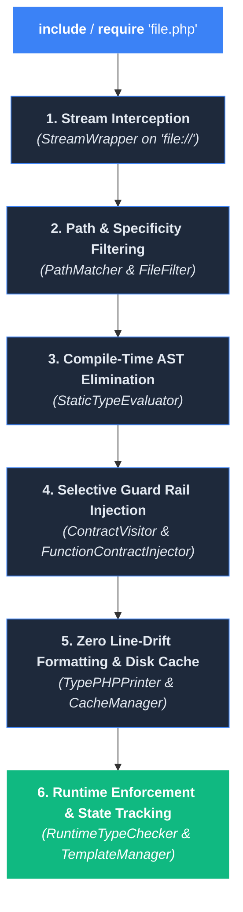
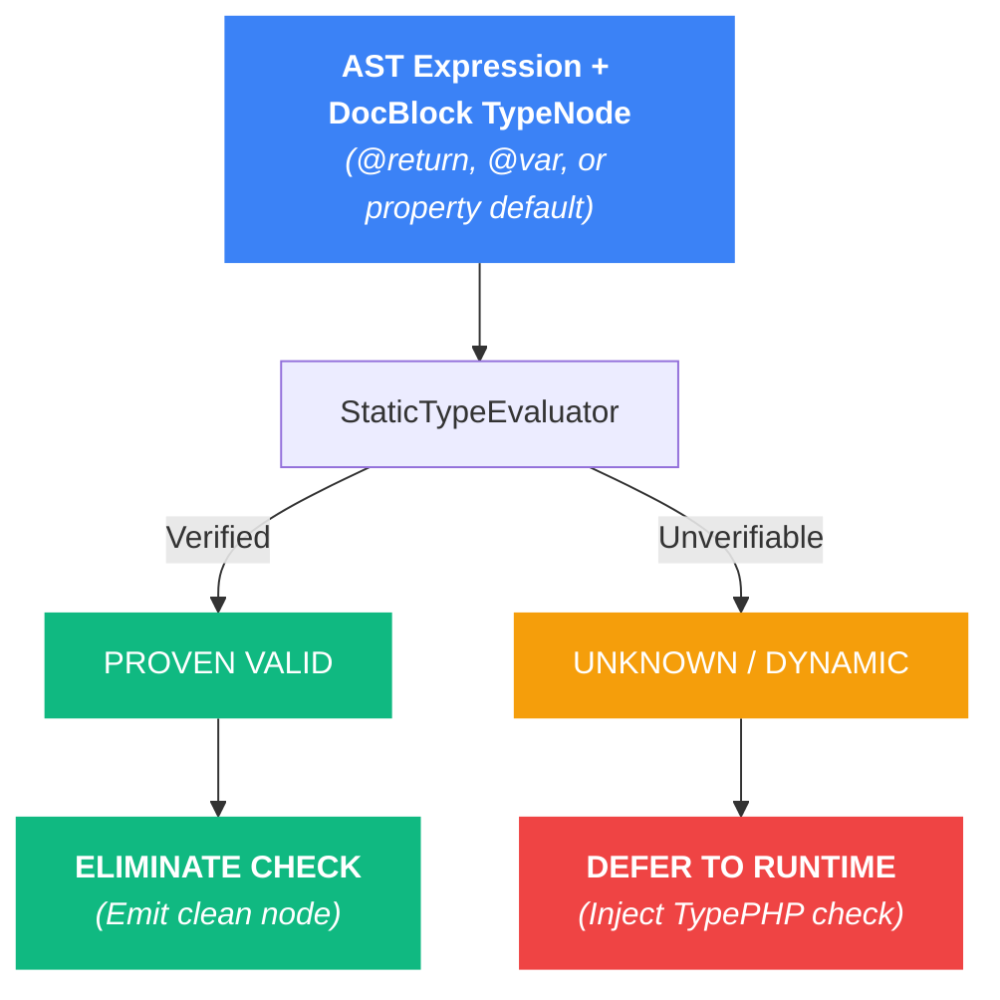

# How It Works

TypePHP provides transparent, zero-overhead runtime type enforcement without custom C-extensions or modified PHP binaries. It operates entirely in PHP user-land by combining native stream interception, compile-time AST analysis, bytecode caching, and in-memory generic state tracking.

---

## Parser Engine Dependencies

TypePHP coordinates two industry-standard parsing libraries:

* **`nikic/php-parser`:** Parses raw PHP source code into statement and expression AST nodes, enabling TypePHP to inspect assignments, function signatures, property hooks, and return expressions to evaluate or inject type checks.
* **`phpstan/phpdoc-parser`:** Tokenizes and parses PHPDoc annotations (`@param`, `@return`, `@template`, `@var`, `@phpstan-type`, `@self-out`, `@param-out`) into strongly typed AST `TypeNode` representations.

---

## The 6-Step Execution Lifecycle



---

## 1. Stream Interception (`StreamWrapper`)

TypePHP overrides PHP's native `file://` protocol handler using `stream_wrapper_register()`.

* **Execution Requests (`include` / `require`):** Detected via the Zend Engine flag `STREAM_OPEN_FOR_INCLUDE` (128) and read modes (`r`, `rb`, `rt`). The file proceeds to path filtering and AST analysis.
* **Read-Only File Operations:** Functions like `file_get_contents()`, `token_get_all()`, `readfile()`, and Phar operations pass through untouched to the native C-level file system, preventing unnecessary overhead or string corruption.
* **Re-entrancy Protection:** Whenever TypePHP needs to read a source file from disk or write transformed code to cache, it temporarily unregisters its stream wrapper, executes the native PHP operation, and re-registers itself, preventing infinite recursion.

---

## 2. Path Filtering & Specificity (`PathMatcher` & `FileFilter`)

TypePHP determines whether a file should be instrumented based on your `include` and `exclude` path globs:

```php
'include' => [
    'src/**',
    'app/**',
    'vendor/my-org/whitelisted-package/**', // Specific vendor inclusion
],
'exclude' => [
    'vendor/**',
    'storage/**',
    'var/**',
    'cache/**',
],
```

### Specificity Hierarchy (Longest Match Rule)
TypePHP evaluates glob patterns using longest-match specificity:
* If you exclude `'vendor/**'` (length 8), but explicitly include `'vendor/my-org/whitelisted-package/**'` (length 35), the longer, more specific include rule wins.
* Excluded files remain 100% untouched native PHP (zero AST parsing, zero disk cache).

### Vendor Boundary Isolation (`CallerBoundaryResolver`)
Whitelisted vendor packages only enforce type contracts when called from **application code** (`src/**`, `app/**`, `tests/**`). If an internal vendor method calls another vendor method, TypePHP detects the vendor-to-vendor boundary and short-circuits validation, allowing third-party frameworks to operate at native speed without crashing on internal quirks.

---

## 3. Compile-Time AST Check Elimination (`StaticTypeEvaluator`)

Before injecting any runtime assertions, TypePHP runs a static type evaluation pass during file compilation. 

### Scope of AST Elimination: `@return`, `@var`, and Property Defaults Only
Compile-time check elimination applies **strictly to `@return` statements, local `@var` assignments, and class property defaults**. It operates on **scalars, non-generic objects, and deterministic arrays/shapes**. 

Function parameters (`@param`) are **deliberately excluded** from caller-side compile-time elimination and are enforced at the callee boundary (see Section 4).



### What Gets Eliminated?
* **Scalar & Range Literals:** `return 42;` vs `@return positive-int`, `return 50;` vs `@return int<1, 100>`.
* **String Literals & Deterministic Concatenations:** `return 'user_' . $id;` vs `@return non-empty-string` (prefix guarantees length $\ge 5$).
* **Empty Arrays:** `return [];` vs `@return list<T>` or `array<K, V>`.
* **Sequential Lists & Shapes:** `return [1, 2, 3];` vs `@return list<positive-int>`, `['id' => 1]` vs `array{id: int}`.
* **Constants & Enums:** `return self::STATUS_PAID;` vs `@return self::STATUS_*`, `return Status::Active;` vs `@return Status::*`.
* **Exact Non-Generic Object Instantiations:** `return new User('Alice');` vs `@return User` (exact FQCN string match, zero reflection, zero autoloading).
* **Identity Returns:** `return $this;` vs `@return $this` / `@return self`, `return new static();` vs `@return static`.
* **Immediate Predecessor Local Data-Flow:**
  ```php
  // Eliminated at compile-time:
  $name = 'Alice';
  return $name; // Preceding statement proved $name is non-empty-string
  ```
* **Local `@var` Assignments:** `/** @var positive-int $x */ $x = 10;` (emits clean `$x = 10;` without `checkVariable()`).
* **Class Property Defaults:** `public int $retries = 3;` vs `@var positive-int` (bypasses constructor synthesis).

### What is Strictly Deferred to Runtime?
* **Reified Generics (`Collection<Dog>`):** Classes with generic template arguments must execute runtime checks to stamp template bindings onto instances in `\WeakMap`.
* **Polymorphic / LSP Boundaries:** Methods in classes with real inheritance (`extends` or `implements`) are deferred to runtime unless they are `private` or declared in a class without inheritance.
* **Dynamic Expressions:** Variables without immediate literal assignments, method calls (`$this->get()`), function calls, and expressions containing dynamic elements.

---

## 4. Callee-Side Parameter Boundaries (`FunctionContractInjector`)

Unlike return expressions and local variable assignments—which can be folded within their declaring file, **parameter contracts (`@param`) are enforced strictly on the callee side (inside the function/method body)**.

### Why Callee-Side Parameter Checking? (The Self-Defending Fortress)

Rather than injecting checks at every call site, TypePHP injects parameter checks at the entry point of the function being called. This architectural decision is required due to PHP’s runtime nature:

1. **The Inversion-of-Control / Testing Boundary:**
   In web frameworks and test runners (Laravel, Symfony, Pest, PHPUnit), application code is routinely invoked by **untransformed, blacklisted vendor code**:

   ```mermaid
   flowchart LR
       A["`**Untransformed Caller**
       *vendor/pestphp/pest/src/...*`"] -->|invokes| B["`**Transformed Target**
       *tests/Feature/OrderTest.php*`"]
       B -->|invokes| C["`**Transformed Target**
       *app/Services/PaymentService.php*
       **(Callee-Side Fortress)**`"]

       style A fill:#64748b,color:#fff,stroke-width:0px
       style B fill:#3b82f6,color:#fff,stroke-width:0px
       style C fill:#10b981,color:#fff,stroke-width:0px
   ```

   If checks were placed on the caller, calls originating from test runners, framework routers, and middleware pipelines would have **no validation code injected**. By enforcing checks at the callee, **whitelisted application files defend their own boundaries regardless of who calls them.**

2. **First-Class Callables (`$service->method(...)`):**
   PHP 8.1+ allows methods to be referenced as first-class callables and executed elsewhere:
   ```php
   $fn = $orderService->process(...); // Callable creation
   $fn($payload);                     // Invocation site
   ```
   At the invocation site, the AST only sees `$fn` (a generic `\Closure`). It has no visibility into what method is being called or what DocBlock annotations it declares. Callee-side enforcement guarantees validation fires the instant `$fn` executes.

3. **Method Chaining (Fluent Builders):**
   In fluent call chains (`$db->table('users')->where('id', $id)->first()`), caller-side validation would require full cross-method return type inference just to identify what method is called next. Callee-side checking allows each method in the chain to independently validate its own incoming arguments.

4. **Dynamic & Variable Invocations:**
   Callee-side checks protect functions called via dynamic dispatch:
   ```php
   $service->$dynamicMethod($arg);
   call_user_func([$service, 'process'], $arg);
   $reflectionMethod->invoke($service, $arg);
   ```

5. **Cross-File Compilation Isolation (No Autoloader Deadlocks):**
   Caller-side checking would require parsing the callee's DocBlock, resolving its traits, parent classes, and imports *while compiling the caller file*. Callee-side checking ensures every file is transformed **100% in isolation**, completely eliminating circular autoloader deadlocks.

6. **1-to-N Code Bloat Prevention:**
   A utility method like `Str::slug()` or `Arr::get()` is declared once but called thousands of times. Callee-side checking injects validation **once** at the declaration, keeping transformed files and OPcache bytecode compact.

---

## 5. Zero Line-Drift Formatting & Bytecode Caching

Injecting multi-line assertion blocks typically alters line numbers, causing stack traces and IDE breakpoints to drift out of sync.

### Zero Line-Drift Guarantee
`TypePHPPrinter` squashes all injected checks into single-line comment blocks:
```php
/*__TYPEPHP_INJECTED_START__*/$_typephpArgs = ['id' => $id]; .../*__TYPEPHP_INJECTED_END__*/
```
Line numbers remain **100% identical** before and after transformation. Exception traces in **Laravel Ignition**, **Symfony ErrorHandler**, **Whoops**, **Pest**, and **PHPUnit** point directly to the exact line in your original source code.

### Two-Tier Disk & Memory Caching (`CacheManager`)
* **Disk Cache (`cache => true`):** Transformed files are saved atomically to `cache_dir` (default: `sys_get_temp_dir() . '/typephp-cache/'`) with restricted permissions (`0700`/`0600`). On subsequent requests:
  * AST parsing runs **0 times**.
  * PHP's **OPcache** compiles the cached file once into shared memory.
* **In-Memory Transformation (`cache => false`):** AST transformations execute purely in RAM using `php://memory` streams (ideal for ephemeral serverless workers or testing).

---

## 6. Runtime Validation & State Architecture

### Reified Generics with `WeakMap` (`TemplateManager`)
When you instantiate a generic object (`/** @var Collection<User> $users */`), TypePHP binds the template type (`T = User`) to that specific object instance in a native `\WeakMap`.
* **Zero Class Alteration:** Object properties and class definitions are not modified.
* **Zero Memory Leaks:** When the object instance is garbage-collected by PHP, its generic state is automatically evicted from `WeakMap`.

### Advanced Variance Engine (`checkVariance`)
TypePHP enforces full generic subtyping rules:
* **Declaration-Site Covariance (`@template-covariant T`):** Allows returning subtypes (`Collection<Dog>` where `Collection<Animal>` is expected).
* **Use-Site Covariance (`Collection<covariant Animal>`):** Enables covariance at specific call sites.
* **F-Bounded Polymorphism (`@template T of Comparable<T>`):** Resolves recursive self-referential bounds with cycle-detection stacks to prevent infinite loops.

### Collection Validation (`full` vs `hybrid`)
* **Strict Full Mode (`'full'`):** Validates every element in every collection ($O(n)$).
* **Beartype Hybrid Mode (`'hybrid'`):** For collections exceeding **128 items** (`Config::HYBRID_SAMPLE_THRESHOLD`), validates container structure (`array_is_list`), boundary elements (first and last), and 3 random internal samples in $O(1)$ constant time.

### Audit Reporting & Lock-Free Parallel Sharding (`ViolationCollector`)
When running in Audit Mode (`on_violation => 'report'`):
* Violations are recorded silently in memory instead of throwing exceptions.
* During parallel test execution (**ParaTest**, **Pest Parallel**), each worker writes to an isolated shard file (`.typephp-shards/shard_{id}.json`) without acquiring file locks.
* At process shutdown, the shards are merged and deduplicated into a unified audit report (`typephp-report.json`).
* If `fail_on_report => true` is configured, TypePHP terminates with exit code `1`, turning the audit report into an automated CI quality gate.