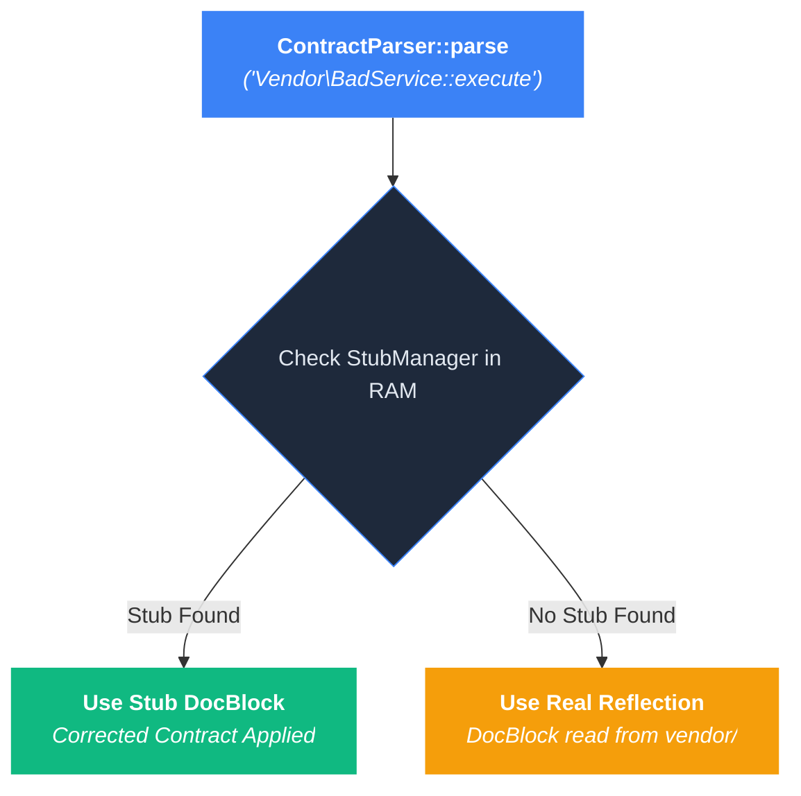

# Stub Files (Third-Party DocBlock Overrides)

TypePHP provides a **Stub System** (mirroring PHPStan and Psalm stub files) that allows you to override, fix, or augment the DocBlocks of third-party vendor packages and legacy code **without modifying a single file in `vendor/`**.

---

## What Are Stub Files and Why Do You Need Them?

Third-party libraries in `vendor/` frequently contain incomplete, outdated, or inaccurate DocBlocks:
* A vendor method promises `list<string>`, but the code accepts `null`.
* A third-party generic collection declares an invariant `@template T`, preventing you from using it covariantly (`Collection<Dog>` $\to$ `Collection<Animal>`).
* A vendor class lacks `@param` or `@return` DocBlocks entirely.

Modifying files directly in `vendor/` is dangerous because running `composer update` will overwrite your changes.

**Stub files solve this problem.** A stub file is a clean PHP file containing empty method bodies and corrected DocBlocks. When TypePHP runs, it reads the contracts from your stub files and enforces them at runtime, completely overriding the vendor package's raw DocBlocks.

---

## How Stubs Work at Runtime



1. **PHPDoc-Only Extraction**: TypePHP extracts **only the DocBlocks** from the stub file. Method bodies remain empty shells (`public function find(int $id): void {}`), and native parameter/return types in the stub are ignored in favor of the real runtime class reflection.
2. **Any File Extension Supported**: You can name your stub files with `.stub`, `.stub.php`, `.php`, `.stubs`, or any custom extension. Using `.stub` is recommended to prevent IDEs from indexing duplicate class definitions.
3. **O(1) Execution Speed**: Stubs are parsed once during boot/cache warm-up into `StubManager` in static memory, adding zero disk I/O to repeated runtime method calls.

---

## Reusing Existing PHPStan & Psalm Stubs

Because TypePHP's docblock parser natively supports `@phpstan-*` and `@psalm-*` annotations, **you do not need to rewrite stub files from scratch** if your vendor packages or ecosystem extensions already ship with PHPStan or Psalm stubs.

You can point the `'stubs'` array in `typephp.php` directly to existing stub directories in `vendor/`:

```php:line-numbers
// typephp.php
return [
    /*
    |--------------------------------------------------------------------------
    | Stub Files (DocBlock Overrides)
    |--------------------------------------------------------------------------
    | Include local custom stubs AND official third-party PHPStan/Psalm stubs.
    */
    'stubs' => [
        'stubs/**',                                  // Local custom stubs
        'vendor/phpstan/phpstan-doctrine/stubs/**',  // Official PHPStan Doctrine stubs
        'vendor/phpstan/phpstan-symfony/stubs/**',   // Official PHPStan Symfony stubs
        'vendor/ramsey/collection/stubs/**',         // Package-provided stubs
    ],

    // ...
];
```

### Supported Community Stub Repositories
You can require third-party stub packages via Composer and immediately reference them in `typephp.php`:
* **`phpstan/phpstan-doctrine`**: Corrects Doctrine ORM collections and entity manager return contracts.
* **`phpstan/phpstan-symfony`**: Corrects Symfony container, request, and response contracts.
* **`phpdoc/stubs`**: Community stubs for legacy PHP extensions and packages.

---

## Namespace & File Structure Guidelines

To ensure TypePHP accurately maps your stub overrides to target vendor classes, follow these rules:

### 1. In-File Namespace and Class Name Must Match the Target FQCN
TypePHP indexes stubs using their **Fully Qualified Class Name (FQCN)**:
* If the target class is `Vendor\Billing\BillingService`, the stub file **must** declare `namespace Vendor\Billing;` and `class BillingService`.
* If the namespace is missing or renamed (e.g. `namespace App\Stubs;`), TypePHP will index the stub under the wrong key and will not apply the override.

```php:line-numbers
// Correct: Target FQCN matches exactly
namespace Vendor\Billing;

class BillingService
{
    /** @param positive-int $id */
    public function find(int $id): void {}
}
```

### 2. File Names and Folder Structures Do NOT Need to Follow PSR-4
Unlike application code, stub files do not have to mirror vendor directory structures on disk:
* Target File: `vendor/vendor-name/package-name/src/Services/BillingService.php`
* Valid Stub File Paths:
  * `stubs/BillingService.stub`
  * `stubs/vendor_fixes.stub.php`
  * `stubs/billing.stub`
  * `stubs/overrides/anything.stubs`

As long as the file is located within a path matched by the `'stubs'` configuration glob in `typephp.php`, TypePHP will load and index it.

### 3. Multiple Namespaces and Classes Can Live in a Single File
You can consolidate multiple vendor overrides into a single stub file by declaring multiple `namespace` blocks:

```php:line-numbers
<?php

namespace Vendor\Auth;

class AuthService
{
    /** @param non-empty-string $token */
    public function verify(string $token): bool {}
}

namespace Vendor\Billing;

class Invoice
{
    /** @var positive-int */
    public int $amount;
}
```

### 4. Method Bodies Must Be Empty Shells
TypePHP only extracts the PHPDoc comments from stubs. Keep method bodies empty (`{}`) and omit unused internal methods to keep stub files clean and maintainable.

---

## Real-World Examples

### 1. Fixing Inaccurate Parameter Contracts in Vendor Packages

Suppose a third-party class in `vendor/acme/legacy-package/src/BillingService.php` has an inaccurate DocBlock that forbids `null`, even though the underlying method parameter has a nullable default value:

#### Target Vendor File (`vendor/acme/legacy-package/src/BillingService.php`):
```php:line-numbers
namespace Acme\Legacy;

class BillingService
{
    /**
     * Inaccurate vendor DocBlock: claims positive-int, but forbids null default!
     * @param positive-int $discountCode
     */
    public function applyDiscount(?int $discountCode = null): void
    {
        // ...
    }
}
```

#### Corrected Stub File (`stubs/BillingService.stub`):
```php:line-numbers
<?php

namespace Acme\Legacy;

class BillingService
{
    /**
     * Corrected DocBlock from Stub File!
     *
     * @param positive-int|null $discountCode
     */
    public function applyDiscount(?int $discountCode = null): void {}
}
```

When `BillingService::applyDiscount(null)` runs at runtime, TypePHP uses the stub's corrected `@param positive-int|null` contract and allows `null` without throwing a `TypeError`.

---

### 2. Making Third-Party Collections Covariant (`@template-covariant T`)

By default, third-party collections (like `ramsey/collection` or `doctrine/collections`) declare their template parameters as invariant (`@template T`).

To make them **covariant** so that `Collection<Dog>` can be passed into functions expecting `CollectionInterface<Animal>`:

#### Create `stubs/ramsey-collection.stub.php`:
```php:line-numbers
<?php

namespace Ramsey\Collection;

/**
 * @template-covariant T
 * @extends ArrayInterface<T>
 */
interface CollectionInterface extends ArrayInterface
{
}

/**
 * @template-covariant T
 * @extends AbstractCollection<T>
 */
class Collection extends AbstractCollection
{
}
```

Now, TypePHP treats `CollectionInterface` and `Collection` as covariant producers across your entire application!

---

### 3. Defining and Importing Type Aliases (`@phpstan-type` & `@phpstan-import-type`)

You can define `@phpstan-type` aliases on third-party classes inside stub files, and import them into your application using `@phpstan-import-type`:

#### Inside `stubs/VendorService.stub`:
```php:line-numbers
<?php

namespace Vendor\Package;

/**
 * @phpstan-type VendorConfig array{apiKey: non-empty-string, retries: positive-int}
 */
class VendorService
{
}
```

#### Inside your application (`src/Services/AppService.php`):
```php:line-numbers
namespace App\Services;

use Vendor\Package\VendorService;

/**
 * @phpstan-import-type VendorConfig from VendorService as AppConfig
 */
class AppService
{
    /**
     * @param AppConfig $config
     */
    public function initialize(array $config): void
    {
        // Enforces array{apiKey: non-empty-string, retries: positive-int} at runtime!
    }
}
```

---

### 4. Overriding Property `@var` & Magic `@method` Annotations

If a third-party class property lacks `@var` annotations or uses dynamic magic methods routed through `__call()`, declare `@var` and `@method` tags in a stub file:

#### Inside `stubs/DynamicClient.stub`:
```php:line-numbers
<?php

namespace Vendor\Package;

/**
 * @method positive-int calculateScore(positive-int $baseScore, non-empty-string $category)
 */
class DynamicClient
{
    /**
     * @var positive-int
     */
    public int $timeout;
}
```

Assigning `$client->timeout = -10` or invoking `$client->calculateScore(-5, 'sports')` will now be strictly validated and rejected by TypePHP at runtime.

---

## Architectural Guarantees

1. **Vendor Isolation is Preserved**: Un-stubbed vendor files in `vendor/` remain completely ignored by `FileFilter`, protecting your application from third-party DocBlock bleed.
2. **Liskov Substitution Principle (LSP)**: Child classes extending stubbed vendor classes or implementing stubbed vendor interfaces automatically inherit the stub's clean contracts.
3. **O(1) Execution Speed**: Stubs are parsed once during boot/cache warm-up into `StubManager` in static memory, adding zero disk I/O to repeated runtime method calls.