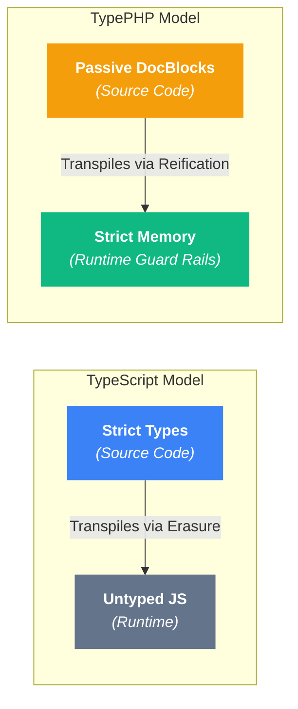

# TypePHP v0.12.0: The Zero-Overhead Compile-Time Optimization Engine

<div class="blog-post-meta" style="margin-bottom: 24px;">
  <span class="blog-badge badge-announcement">Release</span>
  <span>October 28, 2026</span>
  <span class="dot">•</span>
  <span>8 min read</span>
</div>

Today, I am thrilled to announce the release of **TypePHP v0.12.0**.

Alongside this release, I have rolled out a complete redesign of the documentation and enginering blog. Every guide is now equipped with **interactive, executable code snippets running real PHP 8.5 in your browser via WebAssembly**. You no longer have to take my word for how runtime generics or shape validations behave; you can click **Run**, inspect the transformed bytecode, and tweak inputs live on every page.

Before diving into the benchmarks, I have a humorous confession to share about what TypePHP actually is under the hood.

---

## The Dirty Confession: TypePHP is an "Inverse TypeScript" Transpiler

I often describe TypePHP with the tagline: *"Zero build steps, zero transpilation, pure PHP."*

While that is true from a developer ergonomics perspective (you never run Webpack, Babel, or Node.js), looking at the computer science definition reveals an amusing reality:

> **TypePHP is technically a source-to-source transpiler, much like TypeScript, but operating in reverse.**

Consider the architectural contrast:
* **TypeScript** takes rich types at build time and **erases** them into untyped vanilla JavaScript for runtime execution.
* **TypePHP** does the oposite: it takes passive DocBlock comments and **reifies** them into active runtime guard rails inside memory.



What about the *"no build step"* claim?

Technically, **TypePHP does have a hidden build step; it is simply Just-In-Time (JIT) by default.**

When PHP loads a file, TypePHP’s `StreamWrapper` intercepts the `include` stream, parses the AST, folds static expressions, and injects guard rails on-the-fly right before the Zend Engine compiles it to OPcache bytecode. 

For teams that prefer **Ahead-Of-Time (AOT) transpilation** during production deployments, you run:
```bash
vendor/bin/typephp cache:warm
# or
vendor/bin/typephp cache:rebuild
```
This pre-transpiles every included PHP file on disk ahead of time. You get all the safety of a compiled type system without ever leaving pure PHP userland.

Now, let us examine the core innovation of v0.12.0: making this transpiler run at **100% native C-speed**.

---

## 1. Flagship: Compile-Time AST Check Elimination

The biggest historical criticism of runtime type systems is **performance overhead**. If every single getter, property default, and return statement is blindly wrapped in runtime assertion functions, high-throughput loops pay an unnecessary Zend VM call tax.

In **v0.12.0**, I eliminated that tax entirely with **Compile-Time AST Check Elimination**.

When a method returns a literal like `'2.0.0'` against `@return non-empty-string`, or `60 * 60` against `@return positive-int`, or `$this` on a fluent builder, **evaluating that contract at runtime is completely redundant**. The statement is mathematically and syntactically proven safe before the code ever executes.

Starting in v0.12.0, TypePHP's new `StaticTypeEvaluator` analyzes statement expresions against their declared contracts during load-time file transformation. If an expression is statically proven safe:

> **TypePHP completely skips injecting runtime assertion wrappers for that statement.**

### The Benchmark Difference

| Execution Strategy | What Zend VM Executes | Speed | JIT Compatibility |
| :--- | :--- | :--- | :--- |
| **Traditional Runtime Wrapping** | Pushes arguments to stack $\to$ calls `checkReturn()` $\to$ evaluates `T_INSTANCEOF` $\to$ ternary branch (~50 opcodes). | ~800k calls/sec |  JIT refuses to inline dynamic calls |
| **TypePHP v0.12.0 Check Elimination** | **Single `ZEND_RETURN` opcode**. Emits raw, clean PHP. | **~25M+ calls/sec (Native C-Speed)** | **Tracing JIT can inline the leaf method directly.** |

### Test Drive It Live (Inspect the Transformed Source)

Click the **Transformed** tab in the snippet below to inspect the compiled AST. Notice that `getTtl()` and `selfChain()` have **zero assertion wrappers injected**, while the dynamic calculation preserves full runtime guard rails:

<TypePHPSnippet title="Compile-Time AST Elimination in Action" default-view="transformed">

```php:line-numbers
<?php

declare(strict_types=1);

class CacheConfig
{
    /** @return positive-int */
    public function getTtl(): int
    {
        // 60 * 60 folds to 3600 at compile time: proven positive-int, so the check is omitted!
        return 60 * 60;
    }

    /** @return $this */
    public function selfChain(): self
    {
        // $this identity is an absolute truth: check omitted! Fluent chaining runs at native speed.
        return $this;
    }

    /** @return positive-int */
    public function dynamicTtl(int $multiplier): int
    {
        // Dynamic variable multiplication: unverifiable at compile time, so runtime check is injected!
        return $multiplier * 60;
    }
}

$config = new CacheConfig();
echo "Static TTL: " . $config->getTtl() . "s\n";
echo "Dynamic TTL: " . $config->dynamicTtl(5) . "s\n";
```

</TypePHPSnippet>

### What Gets Eliminated?
* **Scalar & Range Literals:** `return 42;` vs `@return positive-int`, `return 50;` vs `@return int<1, 100>`.
* **String Concatenations:** `return 'item_' . $id;` vs `@return non-empty-string` (prefix guarantees length $\ge 5$).
* **Constant & Enum Wildcards:** `return self::STATUS_ACTIVE;` vs `@return self::STATUS_*`.
* **Empty Arrays:** `return [];` vs `@return list<T>` or `array<K, V>`.
* **Sequential Lists & Shapes:** `return [1, 2, 3];` vs `list<int>`, `['id' => 1]` vs `array{id: int}`.
* **Exact Object Instantiations:** `return new User('Alice');` vs `@return User` (exact FQCN string match, zero reflection).
* **Property Defaults:** `public int $timeout = 30;` vs `@var positive-int` (bypasses constructor synthesis).

---

## 2. Interactive Code Everywhere (Docs & Blog)

Reading static code blocks in developer documentation is often passive and unconvincing. With v0.12.0, I overhauled the documentation and blog architecture to run on an embedded **PHP 8.5 WebAssembly engine**.

Every code example across the guides and release posts now allows you to:
1. **Execute live in your browser:** Tap **Run** and watch the real Zend Engine validate inputs in milliseconds.
2. **Inspect the Transformed AST:** Toggle **Transformed** to see exactly what TypePHP injects (and what it statically eliminates).
3. **Inspect the Error Output:** Trigger contract violations and inspect real PHP stack traces with exact call-site line attribution.
4. **Share Compact Snippets:** Share links that are 80% smaller or backed by instant shortlinks (`typephp.dev/#r=...`).

---

## 3. Backed Enum Bitmasks (`int-mask-of<Permission::*>`)

In v0.12.0, I resolved an edge case where bitmasks referencing Backed Enums (`enum Permission: int`) were not correctly extracting integer case values during bitwise validation.

TypePHP now seamlessly resolves bitwise combinations of backed enum cases:

<TypePHPSnippet title="Backed Enum Bitmasks in v0.12.0" default-view="source">

```php:line-numbers
<?php

declare(strict_types=1);

enum Permission: int
{
    case Read = 1;    // 0001
    case Write = 2;   // 0010
    case Delete = 4;  // 0100
}

/**
 * @param int-mask-of<Permission::*> $mask
 */
function applyAccess(int $mask): void
{
    echo "✓ Valid bitmask combination applied: {$mask}\n";
}

// 1. Happy Path: 3 = Read (1) | Write (2)
applyAccess(Permission::Read->value | Permission::Write->value);

// 2. Happy Path: 7 = Read (1) | Write (2) | Delete (4)
applyAccess(7);

echo "\n";

// 3. Failure: 8 is outside any Permission case combination!
echo "Attempting to pass unapproved bitmask 8...\n";
applyAccess(8);
```

</TypePHPSnippet>

---

## 4. Lexical Token Parsing for Robust Zero Line-Drift

A critical architectural guarantee of TypePHP is **Zero Line-Drift**: stack traces in Laravel Ignition, Whoops, Symfony ErrorHandler, Pest, and PHPUnit must point to the **exact line number** of your original source file.

In previous versions, squashing multi-line assertions into single-line blocks relied on regular expressions. In complex edge cases (such as multiline strings containing `#` or `//`), regex could misinterpret comments inside string literals.

In v0.12.0, I replaced regex comment handling with **PHP 8.0+ Lexical Token Parsing** (`\PhpToken::tokenize()`). The printer tokenizes the source code at C-level speed, safely neutralizing trailing comments preceding injected assertions without any risk of corrupting string literals.

---

## 5. The Danger of By-Reference Mutations in PHP (And How v0.12.0 Solves It)

In PHP, references (`&`) represent one of the most surprising, bug-prone language features.

When you create a reference in PHP, the Zend Engine transforms the underlying variable into an internal `zval` alias (`IS_REFERENCE`). Once aliased, any modification to the alias bypasses standard variable assignment interceptors completely:

```php
/**
 *  @var list<positive-int> $scores
 */
$scores = [10, 20, 30];

// The classic PHP footgun:
foreach ($scores as &$score) {
    if ($score === 20) {
        $score = -500; // Sneakily corrupts list<positive-int> in place!
    }
}
unset($score);
```

In standard PHP, no exception is thrown when `$score = -500` runs. The container is silently poisoned with negative numbers, quietly propagating through your services until it causes catastrophic calculation errors downstream.

Similarly, consider **deep member aliasing**:
```php
$ref =& $data['user']['scores'];
$ref[] = 'corrupted_string'; // Directly mutates nested shape without touching root variable!
```

### The Solution in v0.12.0

In v0.12.0, I completely overhauled TypePHP's reference analysis engine:

1. **Loop Boundary Post-Assertions:** When a by-reference loop (`foreach ($items as &$item)`) executes, TypePHP analyzes the loop body. If there is any risk of opaque mutations, an atomic post-boundary check is injected immediately following the loop, guaranteeing that memory corruption is caught before control leaves the scope.
2. **Compile-Time Loop Optimization:** If static AST analysis proves that the loop body contains only safe mathematical operations (e.g., `$score += 5` on `positive-int`), the boundary check is **completely omitted at compile time**, allowing safe loops to run at native C-speed.
3. **Atomic Deep Member-Chain Tracking:** Accessor chains (`$data['user']['scores'][] = ...`) are unpacked into isolated copy mutations and validated atomically before writing to memory.

Try running the by-reference mutation protection live below:

<TypePHPSnippet title="By-Reference Mutation Defense" default-view="source">

```php:line-numbers
<?php

declare(strict_types=1);

/**
 *  @var positive-int $originalScore
 */
$originalScore = 100;

// Create reference alias
$alias =& $originalScore;

// Valid mutation through alias:
$alias += 50;
echo "✓ Valid mutation via alias: Score={$originalScore}\n\n";

// In standard PHP, mutating $alias directly bypasses assignment checks!
// TypePHP tracks the reference target and guards the underlying zval at compile time
// and injects a post-boundary check to catch illegal mutations:

echo "Attempting to assign negative value via reference alias...\n";
$alias = -75;

```

</TypePHPSnippet>

---

## 6. Enhanced Generic Cloning (`__clone`)

When cloning a generic object (`clone $instance`), TypePHP binds template parameters in `\WeakMap` memory. 

In earlier versions, a subtle lifecycle timing gap existed: if a class defined a custom `__clone()` magic method, that method ran *before* external listeners could re-bind template types to the newly cloned object. Any property assignments made *inside* `__clone()` could execute in an unparameterized generic context!

In v0.12.0, I hardened the lifecycle hooks. TypePHP now guarantees that **template bindings are copied to the new instance in `\WeakMap` memory before magic `__clone()` begins execution**.

Click **Run** below to observe how TypePHP protects property assignments performed inside `__clone()`:

<TypePHPSnippet title="Generic Safety Inside __clone() Magic Methods" default-view="source">

```php:line-numbers
<?php

declare(strict_types=1);

class Dog {}
class Vehicle {}

/**
 * @template T
 */
class SmartBox
{
    /** @var T|null */
    public mixed $item = null;

    /** @param T $item */
    public function set(mixed $item): void
    {
        $this->item = $item;
    }

    public function __clone(): void
    {
        echo "Executing __clone() hook...\n";
        // TypePHP pre-copied T = Dog before this method ran!
        // Attempting to assign an invalid Vehicle inside __clone() is blocked instantly:
        $this->set(new Vehicle());
    }
}

/** @var SmartBox<Dog> $box */
$box = new SmartBox();
$box->set(new Dog());
echo "✓ Initialized SmartBox with Dog\n\n";

// Cloning triggers __clone(), where TypePHP actively enforces T = Dog:
echo "Cloning SmartBox...\n";
$clonedBox = clone $box;

```

</TypePHPSnippet>

---

## Upgrading to v0.12.0

To upgrade to v0.12.0 in your project:

```bash
composer update typephp/typephp
```

Clear and rebuild your AST cache to take immediate advantage of compile-time check elimination:

```bash
vendor/bin/typephp cache:rebuild
```

If you have not tried TypePHP yet, you can add it as a development dependency in seconds:

```bash
composer require --dev typephp/typephp
vendor/bin/typephp config:init
```

Give it a spin in your Pest or PHPUnit test suite, experiment with the new code snippets live in our [Interactive WebAssembly Playground](/playground), and let me know what you think on [GitHub](https://github.com/typephp-php/typephp)!