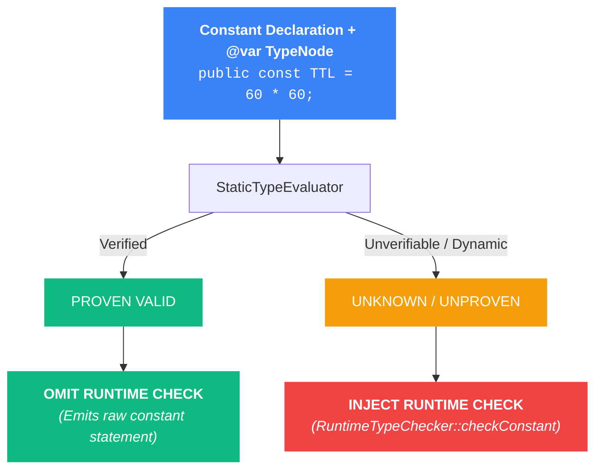

# Constant Contracts

TypePHP enforces type contracts on class constants and global/namespaced constants. By annotating constants with `@var`, TypePHP validates their values during file inclusion, protects constant closures upon invocation, and leverages compile-time check elimination for zero runtime overhead on statically proven values.

::: tip Interactive Learning in Every Snippet:
Every code snippet on this page runs real **PHP 8.5 WebAssembly** directly in your browser.
* Tap **Run** to execute the code live.
* Tap **Edit** in any snippet toolbar to test tweaking types or constant values directly inside this article.
* Tap **↺ (Reset)** anytime to restore the default code.
* Tap **Transformed (AST)** to inspect the zero line-drift compiled bytecode and see check elimination in action.
:::

---

## Class Constants (`Class::CONSTANT`)

Annotate class constants with `@var` to enforce type contracts upon class declaration. TypePHP validates the constant's value immediately when the file is loaded:

<TypePHPSnippet title="Class Constant Validation" default-view="source">

```php:line-numbers
<?php

declare(strict_types=1);

class AppConfig
{
    /**
     * @var positive-int
     */
    public const MAX_RETRIES = 5;

    /**
     * @var int<1, 65535>
     */
    public const DEFAULT_PORT = 8080;

    /**
     * @var 'production'|'staging'|'development'
     */
    public const ENVIRONMENT = 'production';
}

echo "✓ Max Retries: " . AppConfig::MAX_RETRIES . "\n";
echo "✓ Default Port: " . AppConfig::DEFAULT_PORT . "\n";
echo "✓ Environment: " . AppConfig::ENVIRONMENT . "\n\n";

// Violating constant contract:
echo "Evaluating invalid constant declaration...\n";
class InvalidConfig
{
    /**
     * Bug: -1 violates positive-int!
     *
     * @var positive-int
     */
    public const INVALID_TIMEOUT = -1;
}
```

</TypePHPSnippet>

### Visibility & Modifiers
Constant validation applies uniformly across all PHP visibility and modifier levels:
* `public const`
* `protected const`
* `private const`
* `final const` (PHP 8.1+)

---

## Global & Namespaced Constants (`const NAME = ...`)

TypePHP validates global and namespaced constants declared with the `const` keyword at file or namespace scope:

<TypePHPSnippet title="Global & Namespaced Constants" default-view="source">

```php:line-numbers
<?php

declare(strict_types=1);

namespace App\Config;

/**
 * @var non-empty-string
 */
const API_VERSION = 'v2.1';

/**
 * @var array{driver: 'mysql'|'pgsql', host: non-empty-string, port: int<1, 65535>}
 */
const DB_SETTINGS = [
    'driver' => 'pgsql',
    'host' => '127.0.0.1',
    'port' => 5432,
];

echo "✓ API Version: " . API_VERSION . "\n";
echo "✓ DB Driver: " . DB_SETTINGS['driver'] . "\n\n";

// Violating global constant contract:
echo "Evaluating invalid global constant...\n";

/**
 * Bug: Empty string violates non-empty-string!
 *
 * @var non-empty-string
 */
const INVALID_TOKEN = '';
```

</TypePHPSnippet>

---

## Constant Closures (PHP 8.5+ Static Callbacks)

Starting in **PHP 8.5**, PHP allows closures to appear in constant expressions via the [*Closures in Constant Expressions* RFC](https://wiki.php.net/rfc/closures_in_const_expr).

When a constant is assigned a closure and annotated with a callable contract (e.g. `callable(positive-int): non-empty-string`), TypePHP **instruments the closure's body directly**:

1. **Parameter Validation:** When the constant closure is invoked (`(Class::FORMATTER)($arg)`), TypePHP validates all arguments against the declared parameter types.
2. **Return Validation:** Validates the returned value before control returns to the caller.
3. **Compile-Time Inlining:** Safe static returns inside the closure are automatically optimized with compile-time check elimination.

::: warning PHP 8.5 Constant Expression Constraints
To satisfy PHP 8.5's Zend Engine rules for constant expressions, closures in constants must follow these requirements:
* **Must be explicitly `static` (`static function (...) { ... }`):** Non-static closures cannot appear in constant expressions because `$this` cannot be bound in a constant.
* **Arrow functions (`fn () => ...`) are NOT allowed:** PHP forbids short arrow functions in constant expressions because they perform implicit by-value scope capturing.
* **No `use (...)` capturing:** Constant expressions must be immutable values independent of local scope and cannot capture outer variables.
:::

<TypePHPSnippet title="PHP 8.5 Constant Closures (Typed Callbacks)" default-view="source">

```php:line-numbers
<?php

declare(strict_types=1);

class Transformers
{
    /**
     * TypePHP instruments this closure so parameter and return contracts
     * are strictly enforced upon invocation!
     *
     * @var callable(positive-int $id, non-empty-string $prefix): non-empty-string
     */
    public const SLUGIFY = static function (int $id, string $prefix): string {
        return "{$prefix}-{$id}";
    };

    /**
     * @var callable(int $code): array{status: 'ok', code: positive-int}
     */
    public const WRAP_RESPONSE = static function (int $code): array {
        return [
            'status' => 'ok',
            'code' => $code,
        ];
    };
}

// 1. Valid Invocation:
$slugifier = Transformers::SLUGIFY;
$slug = $slugifier(101, 'post');
echo "✓ Generated Slug: {$slug}\n\n";

// 2. Parameter Contract Failure: Passing negative integer to positive-int:
try {
    echo "Invoking constant closure with invalid negative ID...\n";
    $slugifier(-5, 'post');
} catch (\TypeError $e) {
    echo "✗ Parameter Check: " . $e->getMessage() . "\n\n";
}

// 3. Return Contract Failure: Passing -1 causes the closure to return an invalid shape:
try {
    echo "Invoking response wrapper with invalid code -1...\n";
    (Transformers::WRAP_RESPONSE)(-1);
} catch (\TypeError $e) {
    echo "✗ Return Check: " . $e->getMessage() . "\n";
}
```

</TypePHPSnippet>

---

## Compile-Time Check Elimination on Constants

Constants are frequently initialized with literal values, folded arithmetic expressions, or empty arrays.

When `eliminate_statically_proven_checks => true` is active (default), TypePHP's `StaticTypeEvaluator` verifies whether the constant value deterministically satisfies the declared `@var` contract during file transformation.

If the value is proven valid at compile time:
* **Zero runtime checks are injected.**
* The constant declaration remains 100% native PHP code.
* File loading and class registration execute at native C-speed with **zero memory or opcode overhead**.



### Statically Eliminated Scenarios
* **Folded Arithmetic:** `const TTL = 60 * 60;` with `@var positive-int` (folded to `3600`).
* **String Literals:** `const ROLE = 'admin';` with `@var non-empty-string`.
* **Literal Shapes & Lists:** `const PORTS = [80, 443];` with `@var list<positive-int>`.
* **Enum Backing Values:** `const DEFAULT_CASE = Status::ACTIVE->value;` with `@var value-of<Status>`.

::: tip Inspect the Compiled Code
Click **Transformed** in the snippet toolbar below to view the compiled AST code. Notice that proven constants have **no assertion wrappers injected**, while unproven or violating constants receive assertion checks.
:::

<TypePHPSnippet title="Compile-Time Constant Check Elimination" default-view="transformed">

```php:line-numbers
<?php

declare(strict_types=1);

class CachePolicy
{
    /**
     * 60 * 60 is folded to 3600: Proven positive-int -> Check omitted!
     *
     * @var positive-int
     */
    public const TTL = 60 * 60;

    /**
     * Proven array shape -> Check omitted!
     *
     * @var array{host: non-empty-string, ssl: bool}
     */
    public const CONNECTION = [
        'host' => 'redis.internal',
        'ssl' => true,
    ];
}

echo "TTL: " . CachePolicy::TTL . " seconds\n";
echo "Host: " . CachePolicy::CONNECTION['host'] . "\n";
```

</TypePHPSnippet>

---

## Suppressing Checks (`@typephp-ignore`)

To bypass type verification on a specific constant (such as during migrations, legacy integration, or un-refactored configuration files), add `@typephp-ignore` or `@typephp-disable` to the constant's DocBlock:

<TypePHPSnippet title="Constant Suppression with @typephp-ignore" default-view="source">

```php:line-numbers
<?php

declare(strict_types=1);

class LegacySystem
{
    /**
     * TypePHP skips contract validation for this constant!
     *
     * @typephp-ignore
     * @var positive-int
     */
    public const LEGACY_FLAG = -999;
}

// Bypasses validation without error:
echo "✓ Ignored constant value: " . LegacySystem::LEGACY_FLAG . "\n";
```

</TypePHPSnippet>

---

## Audit Mode & Error Diagnostics

When TypePHP runs in Audit Mode (`on_violation => 'report'`), constant violations do not crash execution. Instead, they are captured in memory and output in `typephp-report.json` with kind `'constant'`:

```json:line-numbers
{
  "file": "src/Config/AppConfig.php",
  "line": 15,
  "function": "App\\Config\\AppConfig::TIMEOUT",
  "kind": "constant",
  "target": "TIMEOUT",
  "expected": "positive-int",
  "given": "negative int (-10)",
  "count": 1,
  "caller": null,
  "declared_in": "src/Config/AppConfig.php:15",
  "message": "Constant App\\Config\\AppConfig::TIMEOUT must be of type positive-int, negative int (-10) given"
}
```

In terminal reports (`vendor/bin/typephp report`), constant failures are highlighted with exact file and line coordinates:

```text
  src/Config/AppConfig.php
    Line 15    constant    TIMEOUT      expected positive-int, negative int (-10)
```