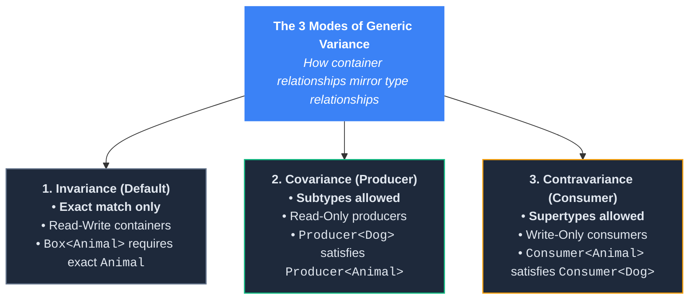
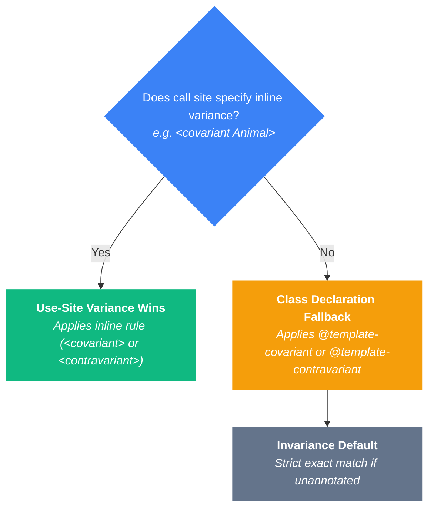

# Generic Variance

Generic variance controls how subtype relationships between underlying types affect the generic container. If `Dog` is a subclass of `Animal`, what is the relationship between a `Producer<Dog>` and a `Producer<Animal>`?

The answer depends on whether the container is **reading data (Producer)**, **writing data (Consumer)**, or **both (Read-Write)**:



---

## Invariance (Default / Read-Write Containers)

By default, generics in TypePHP (and static analyzers) are **invariant**. Invariance requires an **exact type match**.

### Why Invariance is Mandatory for Read-Write Containers

If PHP allowed a `Box<Dog>` to be passed into a function expecting a `Box<Animal>`, the function might try to push a `Cat` into what the caller thought was a box of Dogs. Invariance completely prevents this memory corruption.

<TypePHPSnippet title="Invariance (Default)" default-view="source">

```php:line-numbers
<?php

declare(strict_types=1);

class Animal {}
class Dog extends Animal {}
class Cat extends Animal {}

/** @template T */
class Box
{
    /** @param T $item */
    public function __construct(public mixed $item) {}
}

/**
 * @param Box<Animal> $box
 */
function checkBox(Box $box): void
{
    echo "✓ Box verified as Box<Animal>\n";
}

// 1. Valid Call: Exact match
checkBox(new Box(new Animal()));

// 2. Invalid Call: Dog is a subtype of Animal, but Box is INVARIANT!
echo "\nPassing Box<Dog> into Box<Animal> expectation...\n";
try {
    checkBox(new Box(new Dog()));
} catch (\TypeError $e) {
    echo "✗ Caught invariant mismatch error:\n   " . $e->getMessage() . "\n";
}
```

</TypePHPSnippet>

---

## Covariance (`@template-covariant T` / Producer Mindset)

Covariance allows **subtypes** (e.g. accepting `Dog` where `Animal` is expected). Think of covariance as a **Producer** or **Read-Only** relationship.

If a function only *reads* from a container producing `Animal`s, passing a container producing `Dog`s is 100% safe because every `Dog` read out of the container is guaranteed to be a valid `Animal`.

<TypePHPSnippet title="Covariance (@template-covariant)" default-view="source">

```php:line-numbers
<?php

declare(strict_types=1);

class Animal {}
class Dog extends Animal {}
class Cat extends Animal {}
class Car {}

/**
 * @template-covariant T
 */
class Producer
{
    /** @param T $item */
    public function __construct(public mixed $item) {}
}

/**
 * Accepts Producer holding Animal or any subtype of Animal (Dog, Cat)
 *
 * @param Producer<Animal> $producer
 */
function handleProducer(Producer $producer): void
{
    echo "✓ Producer valid holding: " . get_class($producer->item) . "\n";
}

// 1. Valid: Dog is a subtype of Animal
handleProducer(new Producer(new Dog()));

// 2. Valid: Cat is a subtype of Animal
handleProducer(new Producer(new Cat()));

// 3. Invalid: Car is not an Animal!
echo "\nAttempting to pass Producer<Car>...\n";
try {
    handleProducer(new Producer(new Car()));
} catch (\TypeError $e) {
    echo "✗ Caught subtype violation:\n   " . $e->getMessage() . "\n";
}
```

</TypePHPSnippet>

---

## Contravariance (`@template-contravariant T` / Consumer Mindset)

Contravariance allows **supertypes** (e.g. accepting `Animal` where `Dog` is expected). Think of contravariance as a **Consumer** or **Write-Only** relationship.

If a function needs a handler that consumes a `Dog`, giving it a handler that can consume *any* general `Animal` is 100% safe because an `Animal` handler is perfectly capable of processing any `Dog` you give it.

<TypePHPSnippet title="Contravariance (@template-contravariant)" default-view="source">

```php:line-numbers
<?php

declare(strict_types=1);

class Animal {}
class Dog extends Animal {}
class Puppy extends Dog {}

/**
 * @template-contravariant T
 */
class Consumer
{
    /** @param callable(T): void $handler */
    public function __construct(public mixed $handler) {}
}

/**
 * Accepts Consumer designed for Dog or any SUPERTYPE of Dog (Animal)
 *
 * @param Consumer<Dog> $consumer
 */
function processDogConsumer(Consumer $consumer): void
{
    echo "✓ Consumer valid!\n";
}

// 1. Valid: Animal handler can safely consume a Dog!
$animalHandler = fn (Animal $a) => null;
processDogConsumer(new Consumer($animalHandler));

// 2. Invalid: Puppy handler cannot handle any general Dog!
echo "\nAttempting to pass Consumer<Puppy> into Consumer<Dog> expectation...\n";
try {
    $puppyHandler = fn (Puppy $p) => null;
    processDogConsumer(new Consumer($puppyHandler));
} catch (\TypeError $e) {
    echo "✗ Caught contravariant supertype violation:\n   " . $e->getMessage() . "\n";
}
```

</TypePHPSnippet>

---

## Variance on Variable Assignments

Generic variance is not limited to function parameters and return types. In TypePHP, **variable reassignments with inline `@var` annotations enforce variance rules directly at the assignment statement**:

- **Invariant Containers (Default):** A variable typed as `Collection<Animal>` strictly rejects being assigned a `Collection<Dog>`.
- **Covariant Producers (`@template-covariant`):** A variable typed as `Producer<Animal>` happily accepts a `Producer<Dog>`.
- **Contravariant Consumers (`@template-contravariant`):** A variable typed as `Consumer<Dog>` happily accepts a `Consumer<Animal>`.

<TypePHPSnippet title="Variance Enforcement on Variable Assignments" default-view="source">

```php:line-numbers
<?php

declare(strict_types=1);

abstract class Animal {}
class Dog extends Animal {}
class Cat extends Animal {}

/**
 * 1. INVARIANT (Default)
 * @template T
 */
class Collection
{
    /** @param T $item */
    public function __construct(public mixed $item) {}
}

/**
 * 2. COVARIANT (Producer)
 * @template-covariant T
 */
class Producer
{
    /** @param T $item */
    public function __construct(public mixed $item) {}
}

/**
 * 3. CONTRAVARIANT (Consumer)
 * @template-contravariant T
 */
class Consumer
{
    /** @param callable(T): void $handler */
    public function __construct(public mixed $handler) {}
}

// -----------------------------------------------------------------------------
// Demonstration 1: Covariant Assignment (Subtypes Permitted)
// -----------------------------------------------------------------------------
/** @var Producer<Animal> */
$animalProducer = new Producer(new Dog());

/** @var Producer<Dog> */
$dogProducer = new Producer(new Dog());

// Permitted: Producer is covariant, so Producer<Dog> can be assigned to Producer<Animal>!
$animalProducer = $dogProducer;
echo "✓ Covariant assignment succeeded\n";

// -----------------------------------------------------------------------------
// Demonstration 2: Contravariant Assignment (Supertypes Permitted)
// -----------------------------------------------------------------------------
/** @var Consumer<Dog> */
$dogConsumer = new Consumer(fn (Dog $d) => null);

/** @var Consumer<Animal> */
$animalConsumer = new Consumer(fn (Animal $a) => null);

// Permitted: Consumer is contravariant, so Consumer<Animal> can be assigned to Consumer<Dog>!
$dogConsumer = $animalConsumer;
echo "✓ Contravariant assignment succeeded\n\n";

// -----------------------------------------------------------------------------
// Demonstration 3: Invariant Assignment (Strict Match Required)
// -----------------------------------------------------------------------------
/** @var Collection<Animal> */
$animalCollection = new Collection(new Dog());

/** @var Collection<Dog> */
$dogCollection = new Collection(new Dog());

echo "Attempting to assign Collection<Dog> to variable expecting Collection<Animal>...\n";
try {
    // FAILS! Collection is invariant by default.
    // Assigning a Collection<Dog> into a Collection<Animal> variable is strictly forbidden!
    $animalCollection = $dogCollection;
} catch (\TypeError $e) {
    echo "✗ Invariant assignment rejected:\n   " . $e->getMessage() . "\n";
}
```

</TypePHPSnippet>

### Why TypePHP Guards Invariant Assignments

If TypePHP allowed `$animalCollection = $dogCollection;`, subsequent code could execute:

```php:line-numbers
$animalCollection->item = new Cat();
```

Because `$animalCollection` points to the exact same instance in memory as `$dogCollection`, that statement would sneak a `Cat` into what the rest of your application assumes is a `Collection<Dog>`.

By validating variance directly on variable assignments, TypePHP ensures that **memory corruption is stopped at the exact line where the incompatible reference is assigned**.

---

## Inline Usage-Site Variance Syntax (`<covariant T>`)

In addition to class-level declarations, TypePHP supports declaring variance inline directly on function parameter and return type hints:

```php:line-numbers
/**
 * @param Repository<covariant Animal> $repo
 * @param Consumer<contravariant Dog> $consumer
 * @return Producer<covariant Animal>
 */
function processContracts(Repository $repo, Consumer $consumer): Producer
{
    // ...
}
```

### Variance Precedence Rules (Usage-Site Overrides)

What happens if an inline type hint specifies `Consumer<covariant Animal>`, but the class definition declared `@template-contravariant T`?



**Usage-site modifiers always take precedence:**
1. If a parameter explicitly specifies `<covariant Animal>`, that overrides the class definition for that specific call.
2. If the parameter uses standard syntax `<Animal>`, TypePHP falls back to the class's declared `@template-*` rule.

<TypePHPSnippet title="Usage-Site Variance Override" default-view="source">

```php:line-numbers
<?php

declare(strict_types=1);

class Animal {}
class Dog extends Animal {}
class Car {}

/**
 * Class declares Contravariant T (Default: Consumer / Supertypes)
 *
 * @template-contravariant T
 */
class Consumer
{
    /** @param T $handler */
    public function __construct(public mixed $handler) {}
}

/**
 * Function parameter EXPLICITLY overrides with inline 'covariant Animal'
 *
 * @param Consumer<covariant Animal> $consumer
 */
function processCovariantConsumer(Consumer $consumer): void
{
    echo "✓ Consumer processed successfully!\n";
}

// 1. Valid Call: Dog is a subtype of Animal.
// The class is declared contravariant, BUT the function parameter explicitly 
// specified 'covariant'. Usage-site 'covariant' wins!
processCovariantConsumer(new Consumer(new Dog()));

// 2. Invalid Call: Car is not an Animal!
echo "\nAttempting to pass Consumer<Car>...\n";
try {
    processCovariantConsumer(new Consumer(new Car()));
} catch (\TypeError $e) {
    echo "✗ Usage-site check rejected non-subtype:\n   " . $e->getMessage() . "\n";
}
```

</TypePHPSnippet>

---

## Generic Return Invariance: Strict vs. Pragmatic Mode

A fundamental tension exists between how PHP's native type system operates and how static type checkers enforce generic containers.

### Native PHP Return Covariance (LSP)
Under the **Liskov Substitution Principle (LSP)**, method return types are inherently **covariant**. A subtype method may always return a narrower, more specific type than its parent. This is 100% valid in native PHP 7.4+:

```php:line-numbers
class AnimalShelter {
    public function adopt(): Animal { ... }
}

class DogShelter extends AnimalShelter {
    // Valid Native PHP Covariant Return
    public function adopt(): Dog { ... }
}
```

Because native PHP returns have worked covariantly for years, framework developers in Laravel, Symfony, and Shopware naturally assume that returning a specialized subtype collection (`Collection<Dog>`) from a method promising `Collection<Animal>` is completely valid.

### The Static Analyzer Clash
Static analyzers (PHPStan, Psalm) reject this by default. They treat generic containers as strictly invariant on return unless the author marks the class with `@template-covariant T` or annotates the return type with `<covariant Animal>`. 

Because static analyzers are blind at runtime, they fear that a caller receiving `Collection<Animal>` might try to push a `Cat` into it later in the script.

### The Solution: Pragmatic Return Mode (`strict_return_generic_invariance => false`)
TypePHP bridges the gap between static theory and practical PHP frameworks through a configurable switch in `typephp.php`:

```php:line-numbers
// typephp.php
return [
    /*
    | - true  (Default / Strict): Requires exact invariant match or explicit <covariant T>.
    | - false (Pragmatic Mode): Aligns with native PHP return covariance, allowing
    |         subtypes on return types without explicit docblock tags.
    */
    'strict_return_generic_invariance' => false,
];
```

The snippet below is initialized in **Pragmatic Mode** (`strictReturnGenericInvariance: false`):

<TypePHPSnippet 
  title="Return Covariance: Strict vs. Pragmatic Mode" 
  :config="{ strictReturnGenericInvariance: false }" 
  default-view="source"
>

```php:line-numbers
<?php

declare(strict_types=1);

class Animal {}
class Dog extends Animal {}
class Cat extends Animal {}

/**
 * @template T
 */
class Collection
{
    /** @var array<int, T> */
    public array $items = [];

    /** @param T $item */
    public function add(mixed $item): void
    {
        $this->items[] = $item;
    }
}

/**
 * Promises Collection<Animal>, but returns Collection<Dog>
 *
 * @return Collection<Animal>
 */
function getAnimals(): Collection
{
    /** @var Collection<Dog> $dogs */
    $dogs = new Collection();
    $dogs->add(new Dog());

    // In Strict Mode: Rejected!
    // In Pragmatic Mode: Allowed (matches native PHP return covariance)!
    return $dogs;
}

echo "--- 1. Calling getAnimals() ---\n";
$animals = getAnimals();
echo "✓ Successfully returned Collection<Dog> under Collection<Animal> contract!\n\n";

echo "--- 2. Downstream Write Protection ---\n";
echo "Attempting to sneak a Cat into the returned collection...\n";
// Even in pragmatic mode, WeakMap memory preserves T = Dog on the instance!
try {
    $animals->add(new Cat());
} catch (\TypeError $e) {
    echo "✗ WeakMap caught downstream memory corruption:\n   " . $e->getMessage() . "\n";
}
```

</TypePHPSnippet>

### Try the Interactive Challenge:

1. **Step 1 (Pragmatic Mode)**: Click **Run**.
   - Notice that `getAnimals()` returns `Collection<Dog>` cleanly without errors.
   - However, look at Step 2: the moment code tries to sneak a `Cat` into `$animals`, TypePHP **immediately halts execution**:
     ```text
     TypeError: Collection::add(): Argument $item (template T = Dog) must be of type Dog, Cat given
     ```
   - *Why?* Even though the return boundary allowed the specialized collection to pass, **`\WeakMap` memory never forgot that the instance is locked to `T = Dog`**. Memory corruption is physically impossible.

2. **Step 2 (Switch to Strict Mode)**:
   - Click the **Configuration (⚙️)** gear button in the snippet header above.
   - Toggle **Return Invariance** to **ON** (Strict Mode).
   - Click **Run** again.
   - Notice the error moves to the return boundary:
     ```text
     TypeError: getAnimals(): Return value expects Collection<invariant Animal>, but Collection<Dog> was returned
     ```
   - TypePHP now strictly halts at the return boundary, giving you exact **PHPStan Level MAX invariance parity**.

---

## Freedom from Variance Bans (Read & Write Methods)

In compiled languages and static analyzers, generic classes are subjected to rigid theoretical bans:
- **Static Analyzers Ban Input Parameters on Covariant Classes:** If a class is `@template-covariant T`, static analyzers throw a fatal error if `T` appears in *any* method parameter (claiming it is a "contravariant position").
- **Static Analyzers Ban Return Types on Contravariant Classes:** If a class is `@template-contravariant T`, they ban `T` in *any* return type.

### The Reality of Hybrid Classes
Real-world classes are rarely 100% purely "producers." You might have a read-only, covariant collection, but you need a harmless inspection method:

```php:line-numbers
/** @template-covariant T */
class ReadOnlyCollection
{
    /**
     * Purely read-only! But static analyzers BAN this because $item is an input parameter:
     *
     * @param T $item
     */
    public function contains(mixed $item): bool
    {
        return in_array($item, $this->items, true);
    }
}
```
Static analyzers force you to degrade your types (use `mixed`) or split your classes into messy fragments just to satisfy their linters.

### TypePHP's Runtime Immunity
**TypePHP does not ban write methods on covariant classes or read methods on contravariant classes.** You are completely free to write natural, ergonomic methods.

Because TypePHP tracks real memory via `\WeakMap`, it doesn't need to ban syntax out of fear. It guards the actual instance in real time:

<TypePHPSnippet title="Freedom from Variance Bans" default-view="source">

```php:line-numbers
<?php

declare(strict_types=1);

class Animal {}
class Dog extends Animal {}
class Cat extends Animal {}

/**
 * @template-covariant T
 */
class CovariantContainer 
{
    private array $items = [];

    /** 
     * Write methods are fully permitted in TypePHP!
     * 
     * @param T $item 
     */
    public function addItem(mixed $item): void
    {
        $this->items[] = $item;
    }
}

/** 
 * Accepts CovariantContainer holding Animal or any subtype (like Dog)
 *
 * @param CovariantContainer<Animal> $container 
 */
function sneakCatIntoAnimalContainer(CovariantContainer $container): void
{
    echo "Attempting to push Cat into covariant container...\n";
    // The function assumes $container can take ANY Animal, so it tries to write a Cat!
    $container->addItem(new Cat());
}

/** @var CovariantContainer<Dog> */
$dogContainer = new CovariantContainer();

// TypePHP's WeakMap keeps $dogContainer pinned strictly to T = Dog!
// The mutation is halted dead in its tracks:
try {
    sneakCatIntoAnimalContainer($dogContainer);
} catch (\TypeError $e) {
    echo "✗ WeakMap halted mutation on covariant container:\n   " . $e->getMessage() . "\n";
}
```

</TypePHPSnippet>