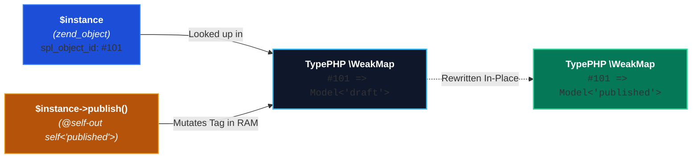

# Mutable Generics & Typestates (`@self-out` & `@this-out`)

In conventional programming languages, an object's generic type parameters are permanently locked upon instantiation. A `Box<int>` remains a `Box<int>` for its entire existence.

TypePHP breaks through this limitation by introducing **In-Place Mutable Generics and Typestates** via `@self-out`, `@this-out`, `@phpstan-self-out`, and `@psalm-self-out`. By decoupling generic identity into `\WeakMap` memory, TypePHP allows an object instance to evolve its generic type dynamically during execution while preserving its physical memory identity.

::: tip Interactive Learning in Every Snippet:
Every code snippet on this page runs real **PHP 8.5 WebAssembly** directly in your browser.
* Tap **Run** to execute the state machine live and inspect uncaught stack traces.
* Tap **Edit** to modify transitions, calls, or parameters directly inside the article.
* Tap **↺ (Reset)** anytime to revert back to the original tutorial state.
* Tap **Transformed (AST)** to inspect the zero line-drift compiled bytecode.
:::

---

## What is Typestate-Oriented Programming (TSOP)?

In traditional Object-Oriented Programming, an object's public methods are visible and callable at all times, even when calling them makes zero logical sense:
* Calling `commit()` on a database connection that was never started.
* Calling `delete()` on a query builder before setting a `where()` clause.
* Calling `getUser()` on a session that has not yet authenticated.

Developers are forced to litter their business logic with defensive runtime assertions like `if (!$this->inTransaction) { throw ... }`.

**Typestate-Oriented Programming solves this problem by embedding the object's lifecycle states directly into its type.** 

Methods act as state transitions: an object in state `Session<'unauthenticated'>` physically cannot be passed into a function requiring `Session<'authenticated'>`. Illegal operations become type contract violations caught at runtime boundaries before invalid code can execute.

---

## How It Works: The `\WeakMap` Reification Engine

Mainstream compiled languages like C# or Swift cannot allow in-place mutable generics because generic types are hard-coded into the physical memory struct on the heap, and mutating them would corrupt virtual method dispatch tables and trigger segmentation faults.

TypePHP accomplishes in-place mutable generics without modifying PHP's internal class tables:



1. **Decoupled Reification:** Generic template arguments are stored in an external `\WeakMap` keyed by the object instance.
2. **Transition Interception:** When a method annotated with `@self-out` completes execution, TypePHP's `SelfOutChecker` intercepts the exit.
3. **In-Place Mutation:** `TemplateManager::bindInstanceFromNode($this, $newType, forceBind: true)` overwrites the instance's type tag in `\WeakMap` memory.
4. **Preserved Identity:** The object ID (`spl_object_id`) and memory reference never change. All variables holding a reference to that instance immediately witness the new generic typestate.

---

## In-Place State Machines (`@self-out`)

Model business workflows where methods are only permitted when an object has reached a specific verified state:

::: tip Try the In-Place Challenge:
1. Click **Run** below to observe the uncaught `TypeError` stack trace when calling `viewSecretDashboard()` on line 54 after logging out.
2. Click **Edit** in the toolbar below.
3. On line 49, remove or comment out `$session->logout();`.
4. Click **Run** again and watch the script complete cleanly with Exit 0 because the session stayed in the authenticated state!
:::

<TypePHPSnippet title="State Machine Transitions via @self-out" default-view="source">

```php:line-numbers
<?php

declare(strict_types=1);

use TypePHP\TypePHP;

/**
 * @template TState of 'unauthenticated'|'authenticated'
 */
class Session
{
    /**
     * Transitions state from 'unauthenticated' to 'authenticated'
     * @self-out self<'authenticated'>
     */
    public function login(): void {}

    /**
     * Transitions state back to 'unauthenticated'
     * @self-out self<'unauthenticated'>
     */
    public function logout(): void {}
}

/**
 * Gatekeeper function: Strictly requires an authenticated session!
 *
 * @param Session<'authenticated'> $session
 */
function viewSecretDashboard(Session $session): void
{
    echo "✓ Access GRANTED to secret dashboard!\n";
}

/**
 * @var Session<'unauthenticated'>
 */
$session = new Session();
echo "Initial State: " . TypePHP::getGenericType($session) . "\n";

// 1. In-place transition to 'authenticated'
$session->login();
echo "State after login(): " . TypePHP::getGenericType($session) . "\n";

// 2. Permitted: Session is authenticated
viewSecretDashboard($session);

// 3. In-place transition back to 'unauthenticated'
$session->logout();
echo "State after logout(): " . TypePHP::getGenericType($session) . "\n\n";

// 4. Calling dashboard with logged-out session triggers an uncaught TypeError!
echo "Attempting to access dashboard with logged-out session...\n";
viewSecretDashboard($session);
```

</TypePHPSnippet>

---

## Fluent Builders (`@this-out`)

When writing fluent query builders or service pipelines that return `$this`, use `@this-out` to enforce that required configuration steps must occur before the object can be consumed:

::: tip Try the In-Place Challenge:
1. Click **Run** below to observe the uncaught `TypeError` stack trace on line 60 when passing the incomplete builder missing `prepare()`.
2. Click **Edit** in the toolbar below.
3. On line 56, chain `->prepare()` directly after `->setTable('orders')`. Notice that using modern PHP 8.4+ syntax, you can chain directly onto `new QueryBuilder()` without outer wrapping parentheses!
4. Click **Run** again and watch both queries execute with Exit 0!
:::

<TypePHPSnippet title="Progressive Fluent Builders (@this-out)" default-view="source">

```php:line-numbers
<?php

declare(strict_types=1);

use TypePHP\TypePHP;

/**
 * @template TStep of 'init'|'configured'|'ready'
 */
class QueryBuilder
{
    public string $table = '';

    /**
     * @this-out self<'configured'>
     */
    public function setTable(string $table): self
    {
        $this->table = $table;
        return $this;
    }

    /**
     * @this-out self<'ready'>
     */
    public function prepare(): self
    {
        return $this;
    }
}

/**
 * Demands a fully prepared builder!
 *
 * @param QueryBuilder<'ready'> $builder
 */
function executeQuery(QueryBuilder $builder): void
{
    echo "✓ Executed query on table '{$builder->table}'\n";
}

/**
 * @var QueryBuilder<'empty'>
 */
$builder = new QueryBuilder();

// 1. Valid Chain: Transitions 'init' -> 'configured' -> 'ready'
$readyBuilder = $builder->setTable('users')->prepare();
echo "Builder State: " . TypePHP::getGenericType($readyBuilder) . "\n";
executeQuery($readyBuilder);

echo "\n";

// 2. Incomplete Chain: Missing prepare() step triggers an uncaught TypeError!
// Uses modern PHP 8.4+ new syntax without wrapping parentheses:
$incomplete = new QueryBuilder()->setTable('orders');
echo "Incomplete Builder State: " . TypePHP::getGenericType($incomplete) . "\n";

echo "Attempting to execute incomplete builder...\n";
executeQuery($incomplete);
```

</TypePHPSnippet>

---

## Dynamic Generic Union Accumulation (`self<T|TNew>`)

Generic containers can use `@self-out` to accumulate and widen their generic template bindings dynamically in memory as heterogeneous items are pushed into the container:

::: tip Try the In-Place Challenge:
1. Click **Run** below to observe `MutableCollection<Dog>` automatically widen to `MutableCollection<(Dog | Cat)>`.
2. Click **Edit** in the toolbar below.
3. On line 37, push an integer or string instead, for instance: `$col->push(100);`.
4. Click **Run** again and check the output to see TypePHP widen the reified memory type to include `int`!
:::

<TypePHPSnippet title="Dynamic Generic Union Accumulation" default-view="source">

```php:line-numbers
<?php

declare(strict_types=1);

use TypePHP\TypePHP;

class Dog {}
class Cat {}

/**
 * @template T
 */
class MutableCollection
{
    public array $items = [];

    /**
     * Dynamically widens the instance's generic template T in WeakMap!
     *
     * @template TNew
     * @param TNew $item
     * @self-out self<T|TNew>
     */
    public function push(mixed $item): void
    {
        $this->items[] = $item;
    }
}

/**
 * @var MutableCollection<Dog>
 */
$col = new MutableCollection();
echo "Initial Type: " . TypePHP::getGenericType($col) . "\n";

// Pushing a Cat dynamically widens the instance's binding to (Dog | Cat)!
$col->push(new Cat());

echo "Type after push(Cat): " . TypePHP::getGenericType($col) . "\n";
```

</TypePHPSnippet>

---

## Speculative Typestate Rollbacks (`InlineChecker`)

A common architectural hurdle in typestate systems occurs when an object method assigns a value to a generic property that is invalid under the current typestate, but becomes valid under the impending typestate declared by `@self-out`:

```php
/**
 * @template T of 'guest'|'authenticated'
 */
class Account
{
    /** @var T */
    public string $status = 'guest';

    /**
     * @self-out self<'authenticated'>
     */
    public function login(): void
    {
        // Under T = 'guest', $this->status must be 'guest'!
        // In standard evaluation, assigning 'authenticated' here would fail immediately!
        $this->status = 'authenticated'; 
    }
}
```

To resolve this, TypePHP’s `InlineChecker::trySelfOutTransition()` implements **Speculative Typestate Rollbacks**:
1. When an assignment to `$this->prop` fails against current bindings, TypePHP inspects the call stack.
2. If the enclosing method declares a `@self-out` transition, TypePHP **speculatively applies the transition in `\WeakMap` memory**.
3. It re-tests whether the property assignment satisfies the future generic contract.
4. If valid, the assignment proceeds smoothly.
5. If the method subsequently throws an exception or fails to complete, TypePHP automatically rolls back the `\WeakMap` entry to its previous state, preventing corrupted intermediate states.

::: tip Try the In-Place Challenge:
1. Click **Run** below to observe how `login()` on line 48 succeeds via speculative transition, while `badAssign()` on line 58 halts with an uncaught `TypeError` on line 37 because it lacks `@self-out`.
2. Click **Edit** in the toolbar below.
3. Add `* @self-out self<'authenticated'>` to the docblock of `badAssign()` right above line 35.
4. Click **Run** again and watch both operations pass cleanly with Exit 0!
:::

<TypePHPSnippet title="Speculative Typestate Rollbacks" default-view="source">

```php:line-numbers
<?php

declare(strict_types=1);

use TypePHP\TypePHP;

/**
 * @template T of 'guest'|'authenticated'
 */
class Account
{
    /**
     * The property is directly typed with generic template T!
     * Under Account<'guest'>, this property strictly demands literal 'guest'.
     *
     * @var T
     */
    public string $status = 'guest';

    /**
     * Successful transition:
     * trySelfOutTransition speculatively tests self<'authenticated'> for the property write!
     *
     * @self-out self<'authenticated'>
     */
    public function login(): void
    {
        $this->status = 'authenticated';
    }

    /**
     * Missing @self-out:
     * Attempting to assign 'authenticated' while T is still 'guest' triggers a TypeError!
     */
    public function badAssign(): void
    {
        $this->status = 'authenticated';
    }
}

/**
 * @var Account<'guest'>
 */
$account = new Account();
echo "Initial State: " . TypePHP::getGenericType($account) . "\n";

// 1. Valid login: Speculatively transitions to 'authenticated' and allows the property write:
$account->login();
echo "State after login(): " . TypePHP::getGenericType($account) . "\n\n";

// 2. Failure demonstration:
/**
 * @var Account<'guest'>
 */
$guestAccount = new Account();

echo "Calling badAssign() on guest account without @self-out...\n";
$guestAccount->badAssign();
```

</TypePHPSnippet>

---

## The Aliasing Model: Why In-Place Mutation Fits PHP

In systems languages like Rust, typestates require affine move semantics, which destroys the old variable and forbids aliased references.

In PHP, applications rely heavily on **shared references and Dependency Injection**:
* A database transaction object is passed into multiple repositories.
* A user session is shared across services and middleware.

Because TypePHP binds typestate metadata to the **physical object instance** (`spl_object_id`) in `\WeakMap`, **all variables holding a reference to that instance witness the state transition immediately**:

```php
/**
 * @var Session<'unauthenticated'>
 */
$sessionA = new Session();

$sessionB = $sessionA; // Both point to the exact same zend_object

// Session A logs in:
$sessionA->login(); // WeakMap mutates the instance in RAM!

// Session B immediately witnesses the authenticated state:
viewSecretDashboard($sessionB); // Passes cleanly!
```

---

## Configuration & Feature Toggles

Typestate evaluation is enabled by default. You can toggle typestate enforcement via `'self_out'` in your `typephp.php` configuration:

```php
// typephp.php
return [
    'self_out' => true, // Set to false to disable @self-out and @this-out validation
];
```

When disabled, methods annotated with `@self-out` or `@this-out` execute as standard PHP methods with zero `\WeakMap` mutation overhead.