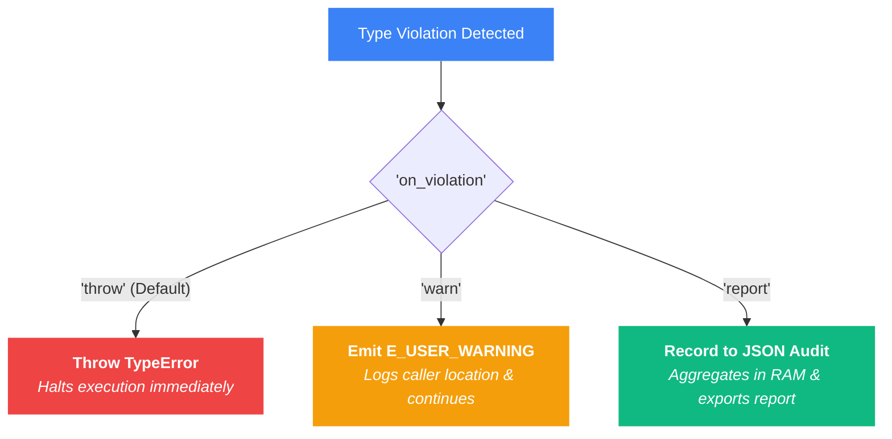
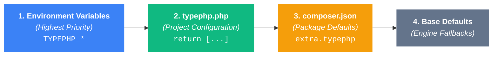

# Configuration

Generate a default `typephp.php` configuration file in your project root directory:

```bash
vendor/bin/typephp config:init
```

---

## Default Configuration Options

```php
<?php

declare(strict_types=1);

return [
    /*
    |--------------------------------------------------------------------------
    | Global Master Switch
    |--------------------------------------------------------------------------
    | Controls whether TypePHP enforces type checks at runtime.
    | Set to false for an emergency kill-switch or zero-overhead benchmarking.
    |
    | Note on Disabling Approaches:
    | - Config Switch ('enabled' => false): TypePHP boots normally, but turns all
    |   runtime checks into instant no-ops (pass-through mode).
    | - Bootstrap Prevention (TYPEPHP_DISABLE=true): To completely prevent TypePHP
    |   from booting or registering its stream wrapper during Composer autoload,
    |   set the environment variable TYPEPHP_DISABLE=true or define('TYPEPHP_DISABLE', true)
    |   before requiring 'vendor/autoload.php'.
    */
    'enabled' => true,

    /*
    |--------------------------------------------------------------------------
    | Eliminate Statically Proven Checks (Compile-Time Optimization)
    |--------------------------------------------------------------------------
    | When true (default), TypePHP analyzes AST expressions during file
    | transformation and omits runtime assertions for code that is
    | mathematically or logically proven to satisfy the DocBlock contract at
    | compile time (e.g. literal returns, property defaults, empty arrays,
    | constant wildcards, and exact non-generic object instantiations).
    |
    | Dynamic expressions, variables, and generic objects continue to be
    | deferred to strict runtime checks.
    |
    | Set to false for deep debugging, tracing every single check in stack traces,
    | or benchmarking unoptimized AST instrumentation.
    |
    | Can also be set via environment variable:
    |   TYPEPHP_ELIMINATE_STATICALLY_PROVEN_CHECKS=false
    | Can also be configured in root composer.json:
    |   "extra": { "typephp": { "eliminate-statically-proven-checks": false } }
    */
    'eliminate_statically_proven_checks' => true,

    /*
    |--------------------------------------------------------------------------
    | Auto-Boot on Composer Autoload
    |--------------------------------------------------------------------------
    | When true (default), TypePHP automatically hooks into the stream wrapper
    | as soon as 'vendor/autoload.php' is required.
    |
    | Set to false to disable auto-booting project-wide. You can then manually
    | boot TypePHP where desired (e.g. in 'tests/bootstrap.php') via:
    |   \TypePHP\TypePHP::boot();
    |
    | Can also be configured in root composer.json:
    |   "extra": { "typephp": { "auto-boot": false } }
    */
    'auto_boot' => true,

    /*
    |--------------------------------------------------------------------------
    | Violation Handling Strategy & Audit Reporting
    |--------------------------------------------------------------------------
    | Controls what happens when a type contract is violated at runtime:
    |
    | - 'throw'  : (Default / Strict) Immediately throws TypePHP\Exception\TypeError.
    | - 'report' : (Audit Mode) Does not throw; records each unique violation
    |              and dumps a structured JSON audit report to 'report_file' at shutdown.
    | - 'warn'   : Emits PHP E_USER_WARNING once per unique violation to your logs
    |              and allows execution to continue normally without crashing.
    |
    | 'report_file'        : Sets the target JSON output path when 'report' mode is active.
    | 'fail_on_report'     : When true, terminates the process with exit code 1 at shutdown
    |                        if the violation report is non-empty. Useful for CI gates.
    | 'fail_on_zero_files' : When true, terminates the process with exit code 1 if 0 application
    |                        files were instrumented. Prevents CI passes when include patterns match nothing.
    */
    'on_violation'       => 'throw',
    'report_file'        => null,
    'fail_on_report'     => false,
    'fail_on_zero_files' => false,

    /*
    |--------------------------------------------------------------------------
    | Global Value Redaction
    |--------------------------------------------------------------------------
    | When true, TypePHP redacts all raw parameter, return, property, and
    | variable values from TypeError exception messages and audit reports,
    | displaying only their types (e.g. 'string given' instead of 'secret_pwd').
    |
    | Useful for production environments, staging logs, and HIPAA/GDPR compliance.
    |
    | Can also be set via environment variable: TYPEPHP_REDACT_VALUES=true
    | Can also be configured in root composer.json:
    |   "extra": { "typephp": { "redact-values": true } }
    */
    'redact_values' => false,

    /*
    |--------------------------------------------------------------------------
    | Function Boundary Contracts (@param, @return, @param-out, @self-out)
    |--------------------------------------------------------------------------
    | Controls whether function and method parameter, return, and by-reference
    | out-parameter contracts are enforced at runtime.
    | When enabled, all parameter and return types (generics, shapes, scalars)
    | are enforced uniformly to maintain type state consistency.
    */
    'params'     => true,
    'returns'    => true,
    'params_out' => true,
    'self_out'   => true,

    /*
    |--------------------------------------------------------------------------
    | Strict Generic Return Invariance (PHPStan / Psalm Parity)
    |--------------------------------------------------------------------------
    | When true (default / strict), generic return types enforce invariance
    | matching PHPStan Level MAX. Returning Collection<Dog> when Collection<Animal>
    | is promised will be rejected unless the class declares '@template-covariant'
    | or the return type specifies use-site covariance '<covariant Animal>'.
    |
    | Set to false (pragmatic mode) when integrating with frameworks like Shopware,
    | Laravel, or legacy codebases where collection classes omit '@template-covariant'.
    */
    'strict_return_generic_invariance' => true,

    /*
    |--------------------------------------------------------------------------
    | Vendor Boundary Only Enforcement
    |--------------------------------------------------------------------------
    | When true (default), whitelisted vendor packages (e.g. Illuminate\Collections)
    | only enforce type contracts on calls originating from application code (included paths).
    | Internal vendor-to-vendor or vendor-self calls bypass strict enforcement.
    | Set to false for strict pedantic enforcement across all vendor internals.
    */
    'vendor_boundary_only' => true,

    /*
    |--------------------------------------------------------------------------
    | Magic Annotations (@property & @method)
    |--------------------------------------------------------------------------
    | Enforces class-level annotations for dynamic properties and magic methods
    | routed through __get, __set, __call, and __callStatic.
    |
    | 'magic_properties' supports granular options:
    | - 'write': (Default: true) Validates dynamic property assignments via __set()
    |            against @property and @property-write annotations.
    | - 'read' : (Default: false) Validates dynamic property access via __get()
    |            against @property and @property-read annotations. Keep false
    |            when working with frameworks (e.g. Eloquent/Doctrine) where
    |            newly instantiated models return unpopulated null attributes.
    |
    | Alternatively, set 'magic_properties' => false to disable all checks.
    */
    'magic_properties' => [
        'write' => true,
        'read'  => false,
    ],
    'magic_methods' => true,

    /*
    |--------------------------------------------------------------------------
    | Respect Ignore Docblock Tags
    |--------------------------------------------------------------------------
    | When true (default), @typephp-ignore and @typephp-ignore-file docblock tags
    | skip type-checking on specific methods/files. Set to false in CI/CD or
    | audit runs to force type-checking on all ignored methods without deleting
    | the docblock tags from source code.
    */
    'respect_ignore_tags' => true,

    /*
    |--------------------------------------------------------------------------
    | Ignore Tag Stack Trace Depth
    |--------------------------------------------------------------------------
    | Controls how many stack frames above a failing type check TypePHP will
    | inspect to find an enclosing @typephp-ignore or @typephp-disable tag.
    | Default is 25 frames. Increase this if your application or test suite
    | uses deep call stacks (e.g. pipelines, middlewares, or nested callers).
    */
    'ignore_trace_depth' => 25,

    /*
    |--------------------------------------------------------------------------
    | Array Validation Strategy
    |--------------------------------------------------------------------------
    | Controls how collections (list<T>, array<K, V>, Type[]) are verified:
    |
    | - 'full'   : (Default / Strict) 100% exhaustive scan. Checks every single 
    |             item in every array, guaranteeing every single offending item
    |             is caught without exception.
    |
    | - 'hybrid' : (Beartype O(1) Mode) Fast boundary + random sampling on
    |             arrays > 128 items. Ideal for massive production datasets.
    */
    'array_validation' => 'full',

    /*
    |--------------------------------------------------------------------------
    | Respect Native Parameter Nullability
    |--------------------------------------------------------------------------
    | When true (default), if a native PHP parameter explicitly declares
    | nullable syntax (e.g. ?array $param = null), TypePHP permits null even
    | if the DocBlock author omitted "|null" (e.g. @param string[] $param).
    |
    | Set to false for strict pedantic enforcement where DocBlocks are the
    | absolute law and null is rejected unless explicitly typed in the DocBlock.
    */
    'respect_native_nullability' => true,

    /*
    |--------------------------------------------------------------------------
    | Enable Caching & Cache Directory
    |--------------------------------------------------------------------------
    | When enabled, transformed PHP files are cached on disk for speed.
    | Set to false to run AST transformations purely in RAM (php://memory).
    |
    | 'cache_dir' determines where these files are stored. By default (null), 
    | it uses your system's temp directory. You can change this to a path
    | inside your project, e.g., __DIR__ . '/storage/framework/typephp'.
    | TypePHP will automatically protect this directory from being re-transformed.
    */
    'cache' => true,
    'cache_dir' => null,

    /*
    |--------------------------------------------------------------------------
    | Cache File Modification Monitor
    |--------------------------------------------------------------------------
    | When enabled (default), TypePHP checks file modification times (filemtime)
    | to automatically rebuild the cache when a file changes.
    | 
    | In production, files do not change. Set this to FALSE to eliminate 
    | hundreds of disk I/O checks per request for maximum performance.
    | Note: If disabled, you must run `php bin/typephp cache:clear` on deployment.
    */
    'cache_check_mtime' => true,

    /*
    |--------------------------------------------------------------------------
    | Registered Extensions
    |--------------------------------------------------------------------------
    | Explicitly list third-party extension classes that provide path overrides.
    */
    'extensions' => [
        // \Acme\Domain\TypePHPExtension::class,
    ],

    /*
    |--------------------------------------------------------------------------
    | Stub Files (DocBlock Overrides for Third-Party & Vendor Packages)
    |--------------------------------------------------------------------------
    | Path globs or specific file paths containing stub files (.stub, .stub.php, .php)
    | that override inaccurate or missing DocBlocks in third-party vendor packages.
    */
    'stubs' => [
        // 'stubs/**',
    ],

    /*
    |--------------------------------------------------------------------------
    | Inline Variable Validation (@var $x = ...)
    |--------------------------------------------------------------------------
    | Fine-grained control over which type categories are enforced on local
    | variable assignments with inline @var Type $var docblocks.
    |
    | Supported options:
    | - 'properties': Validates class property assignments (e.g. $this->id = 1).
    | - 'generics'  : Prebinds generic template instances (e.g. Collection<Dog>).
    | - 'callables' : Wraps inline callbacks (e.g. callable(int): string).
    | - 'scalars'   : Enforces scalar constraints (e.g. positive-int, non-empty-string).
    | - 'arrays'    : Enforces array shapes, lists, & typed arrays (e.g. array{id: int}, int[]).
    | - 'objects'   : Enforces class instance checks (e.g. @var User $user).
    */
    'inline_vars' => [
        'properties' => true,
        'generics'   => true,
        'callables'  => true,
        'scalars'    => true,
        'arrays'     => true,
        'objects'    => true,
    ],

    /*
    |--------------------------------------------------------------------------
    | Included Paths & Whitelisting
    |--------------------------------------------------------------------------
    | Globs or specific file paths that should be intercepted and type-checked.
    |
    | Pattern Specificity:
    | More specific patterns take precedence over broader rules.
    | You can specify directory globs (e.g. 'src/**'), single vendor packages
    | (e.g. 'vendor/my-org/my-package/**'), or single specific files
    | (e.g. 'vendor/monolog/monolog/src/Monolog/Logger.php').
    */
    'include' => [
        'src/**',
        'app/**',
        'tests/**',
        // 'vendor/my-org/my-package/**', // Whitelist a vendor package
    ],

    /*
    |--------------------------------------------------------------------------
    | Excluded Paths & Single-File Blacklisting
    |--------------------------------------------------------------------------
    | Globs or specific file paths that should be ignored by the type checker.
    | You can exclude entire directories (e.g. 'vendor/**') or blacklist
    | single legacy files inside included directories (e.g. 'src/Legacy/UnsafeFile.php').
    */
    'exclude' => [
        'vendor/**',
        'storage/**',
        'var/**',
        'cache/**',
        // 'src/Legacy/UnsafeFile.php', // Blacklist a single specific file
    ],
];
```

---

## Violation Handling Strategy Flow

When a type contract is violated, TypePHP routes execution based on your `'on_violation'` configuration:



---

## Root `composer.json` Configuration (`extra.typephp`)

In addition to `typephp.php`, key project-level options can be configured directly inside your root `composer.json` file under the `"extra.typephp"` key. 

This allows team repositories, monorepos, and packages to enforce project-level booting, optimization, and reporting rules without requiring developers to create a separate `typephp.php` file:

```json
{
  "name": "acme/project",
  "require-dev": {
    "typephp/typephp": "^0.11"
  },
  "extra": {
    "typephp": {
      "auto-boot": false,
      "eliminate-statically-proven-checks": true,
      "on-violation": "report",
      "report-file": "var/typephp-report.json",
      "fail-on-report": true,
      "fail-on-zero-files": true,
      "redact-values": true
    }
  }
}
```

### Supported `composer.json` Options

* **`"auto-boot"`**: Controls whether TypePHP automatically hooks into the stream wrapper on `vendor/autoload.php`. Set to `false` to require manual `\TypePHP\TypePHP::boot()` initialization (such as in `tests/bootstrap.php`).
* **`"eliminate-statically-proven-checks"`**: Controls whether TypePHP analyzes AST expressions during file transformation to skip injecting assertions for code that is proven valid at compile time.
* **`"on-violation"`**: Sets the violation handling mode (`"throw"`, `"report"`, or `"warn"`).
* **`"report-file"`**: Sets the JSON report output file path.
* **`"fail-on-report"`**: Enables CI gatekeeping (exits with status `1` at shutdown if the audit report contains violations).
* **`"fail-on-zero-files"`**: Controls whether TypePHP terminates with exit code `1` if zero application files were instrumented. Prevents CI builds from falsely passing when include patterns match nothing.
* **`"redact-values"`**: Enables global value redaction across all exception messages and audit reports.

---

## Configuration Precedence Hierarchy

TypePHP resolves configuration settings using a deterministic priority hierarchy:



1. **Environment Variables (Highest Priority):** `TYPEPHP_AUTO_BOOT`, `TYPEPHP_ELIMINATE_STATICALLY_PROVEN_CHECKS`, `TYPEPHP_ON_VIOLATION`, `TYPEPHP_REPORT_FILE`, `TYPEPHP_FAIL_ON_REPORT`, `TYPEPHP_FAIL_ON_ZERO_FILES`, `TYPEPHP_REDACT_VALUES`.
2. **`typephp.php` Config File:** Overrides `composer.json` settings if explicitly defined in `typephp.php`.
3. **`composer.json` (`extra.typephp`):** Used when `typephp.php` does not explicitly set the option.
4. **Base Defaults:** `eliminate_statically_proven_checks: true`, `auto_boot: true`, `on_violation: 'throw'`, `report_file: null`, `fail_on_report: false`, `fail_on_zero_files: false`, `redact_values: false`.

---

## Configuration Reference

| Configuration Option | Default | Description |
| :--- | :--- | :--- |
| **`'enabled'`** | `true` | Global master switch for runtime type enforcement. |
| **`'eliminate_statically_proven_checks'`** | `true` | Enables compile-time AST check elimination. When enabled, TypePHP inspects AST expressions during file transformation and skips injecting runtime wrappers for statements mathematically or logically proven to be valid at compile time (e.g. literal returns, property defaults, empty arrays, constant wildcards, and exact non-generic class instantiations). Can also be configured in `composer.json` (`extra.typephp.eliminate-statically-proven-checks`) or via `TYPEPHP_ELIMINATE_STATICALLY_PROVEN_CHECKS`. |
| **`'auto_boot'`** | `true` | Controls whether TypePHP automatically registers its stream wrapper upon `vendor/autoload.php`. Set to `false` to disable auto-booting project-wide and initialize manually via `\TypePHP\TypePHP::boot()`. Can also be configured in `composer.json` (`extra.typephp.auto-boot`). |
| **`'on_violation'`** | `'throw'` | Violation handling strategy: `'throw'` (immediately throws `TypeError`), `'report'` (silent audit mode exporting to JSON report), or `'warn'` (emits `E_USER_WARNING` to logs). Can also be set in `composer.json` (`extra.typephp.on-violation`) or via `TYPEPHP_ON_VIOLATION`. |
| **`'report_file'`** | `null` | Output file path for JSON audit report when `'report'` mode is active. Can also be set in `composer.json` (`extra.typephp.report-file`) or via `TYPEPHP_REPORT_FILE`. |
| **`'fail_on_report'`** | `false` | When `true`, terminates the process with exit code `1` at shutdown if the audit report contains violations. Also enforces that at least one file was instrumented. Can also be set in `composer.json` (`extra.typephp.fail-on-report`) or via `TYPEPHP_FAIL_ON_REPORT`. |
| **`'fail_on_zero_files'`** | `false` | When `true` (or when `fail_on_report` is enabled in CI), terminates the process with exit code `1` at shutdown if 0 application files were instrumented matching the configured `include` patterns. Prevents false-negative clean passes in CI pipelines when path globs match nothing. Can also be set in `composer.json` (`extra.typephp.fail-on-zero-files`) or via `TYPEPHP_FAIL_ON_ZERO_FILES`. |
| **`'redact_values'`** | `false` | When `true`, redacts all raw argument, return, property, and variable values from `TypeError` exception messages and audit reports, displaying only their types (e.g. `'string given'` instead of `'secret_pwd'`). Essential for production logs and HIPAA/GDPR compliance. Can also be set in `composer.json` (`extra.typephp.redact-values`) or via `TYPEPHP_REDACT_VALUES`. |
| **`'params'`** | `true` | Enforces parameter `@param` contracts on functions and methods. |
| **`'returns'`** | `true` | Enforces return `@return` contracts on functions and methods. |
| **`'params_out'`** | `true` | Enforces by-reference out-parameter `@param-out` post-conditions on function and method exits. |
| **`'self_out'`** | `true` | Enforces generic state transitions on `$this` (`@self-out` / `@this-out`) upon method exit. |
| **`'strict_return_generic_invariance'`** | `true` | Enforces strict generic return invariance matching PHPStan Level MAX. Set to `false` (pragmatic mode) for frameworks (Laravel, Shopware) where collection classes omit covariance annotations. |
| **`'vendor_boundary_only'`** | `true` | Whitelisted vendor classes only enforce type contracts when called from application code (`app/**`, `src/**`, `tests/**`). Calls originating from excluded vendor files or internal self-calls bypass strict checking. |
| **`'magic_properties'`** | `['write' => true, 'read' => false]` | Enforces class-level `@property`, `@property-read`, and `@property-write` annotations. |
| **`'magic_methods'`** | `true` | Enforces class-level `@method` annotations on dynamic method calls (`__call` / `__callStatic`). |
| **`'respect_ignore_tags'`** | `true` | Respects `@typephp-ignore` and `@typephp-ignore-file` tags. Set to `false` in CI/CD to force full audit checks. |
| **`'ignore_trace_depth'`** | `25` | Maximum number of stack frames above a failing type check TypePHP will inspect to find an enclosing `@typephp-ignore` or `@typephp-disable` tag. |
| **`'respect_native_nullability'`** | `true` | Permits `null` if native PHP explicitly declares nullable syntax (`?Type` or `Type\|null = null`) even if omitted in the DocBlock. |
| **`'array_validation'`** | `'full'` | Validation strategy for collections: `'full'` (exhaustive $O(n)$) or `'hybrid'` (Beartype $O(1)$ sampling for $> 128$ items). |
| **`'cache'`** | `true` | Pre-transforms and caches PHP files on disk. Set to `false` to transform files purely in memory (`php://memory`). |
| **`'cache_dir'`** | `null` | Custom path to store cached files. Defaults to system temporary directory (`sys_get_temp_dir() . '/typephp-cache-' . $userHash`). |
| **`'cache_check_mtime'`** | `true` | When `true` (default), checks `@filemtime` on file load to automatically rebuild the cache when source files change. Set to `false` in production to eliminate all disk `stat()` calls. |
| **`'extensions'`** | `[]` | Explicit list of third-party extension classes implementing `ExtensionInterface`. |
| **`'stubs'`** | `[]` | Path globs pointing to `.stub` files that override third-party vendor DocBlocks. |
| **`'inline_vars'`** | `[...]` | Fine-grained configuration for local `@var` variable validations. |
| **`'include'`** | `[...]` | Path globs to intercept and type-check. |
| **`'exclude'`** | `[...]` | Path globs to ignore and leave untouched. |