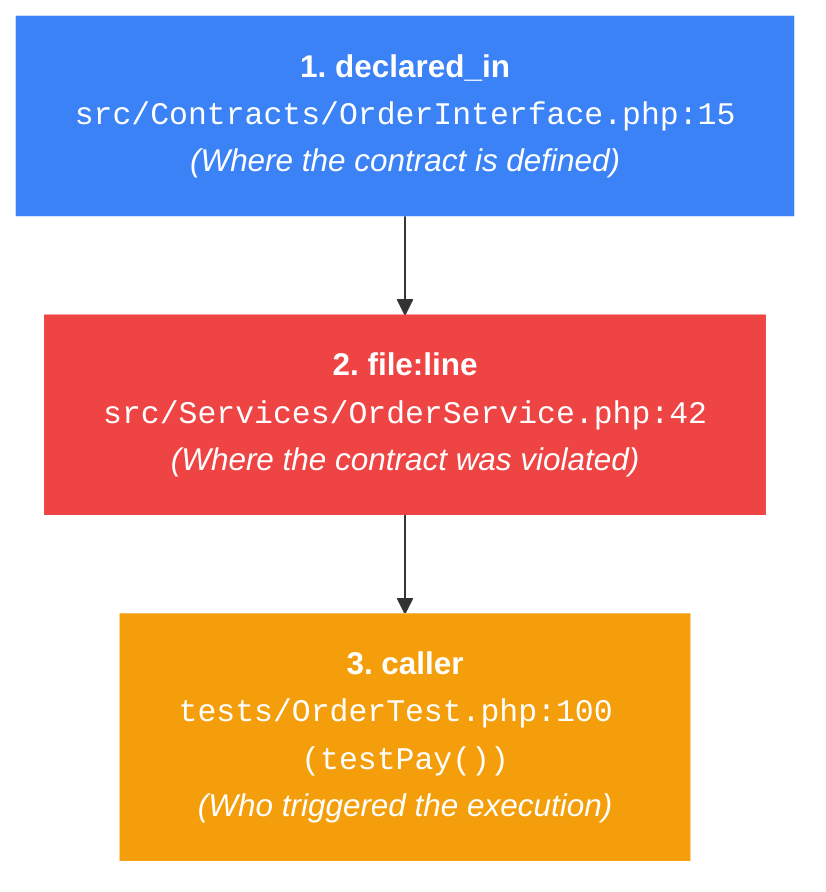
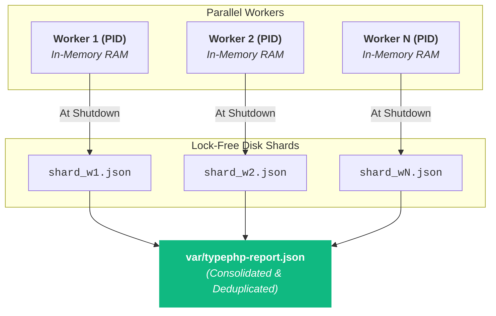

# Violation Reporting & Auditing

TypePHP provides three violation handling strategies (`throw`, `report`, and `warn`), giving you complete control over how contract failures are handled during execution.

In addition to serving as a strict fail-fast gatekeeper in development, TypePHP can run as a **non-fatal codebase auditor**. In audit mode, it collects all type discrepancies across an entire test suite, monorepo, or staging application into a single structured JSON report without interrupting execution.

---

## Overview of Violation Strategies

You can configure the active handling strategy via `'on_violation'` in `typephp.php`, through `composer.json` (`extra.typephp.on-violation`), or via environment variables:

| Strategy | Behavior | Best Used For |
| :--- | :--- | :--- |
| **`'throw'`** *(Default)* | Throws `TypeError` on the first violation. Telemetry tracking is disabled for **0 memory overhead**. | Production gatekeeping, local feature development, and strict test suites. |
| **`'warn'`** | Suppresses exceptions; emits a native PHP `E_USER_WARNING` with exact caller locations once per unique violation and continues execution normally. Telemetry tracking is disabled for **0 memory overhead**. | Live staging logs, local dev server logs, and APM monitoring (Sentry / Datadog / Bugsnag). |
| **`'report'`** | Suppresses exceptions; activates telemetry to track instrumented files, records all unique violations into memory, tracks occurrence frequencies, and exports a structured JSON report to `report_file` at shutdown. | 1-pass codebase audits, legacy migration, multi-module test runs, and non-blocking CI build gates. |

---

## Strict Fail-Fast Mode (Default)

By default (`'on_violation' => 'throw'`), TypePHP operates as a strict runtime gatekeeper. The moment an invalid argument, return value, or property assignment occurs, TypePHP halts execution immediately by throwing a standard `TypeError`:

<TypePHPSnippet title="Strict Fail-Fast (throw Mode)" default-view="source">

```php:line-numbers
<?php

declare(strict_types=1);

/**
 * @param positive-int $id
 * @param non-empty-string $username
 */
function findUser(int $id, string $username): void
{
    echo "✓ Found user #{$id}: {$username}\n";
}

// 1. Valid Call
findUser(42, 'Alice');

// 2. Invalid Call: Halts execution immediately on line 19!
echo "\nPassing negative ID into findUser()...\n";
findUser(-5, 'Alice');

echo "This line will never be reached!\n";
```

</TypePHPSnippet>

---

## Real-Time Warnings (`warn` Mode)

In live staging environments, local dev servers (Laravel Herd, Docker, PHP-FPM), or monitoring pipelines, `'on_violation' => 'warn'` emits a native PHP `E_USER_WARNING` directly to your error stream while allowing the web request or CLI command to finish normally.

### Location-Aware Warnings in Amber

To prevent log files from bloating when a violation occurs inside a high-volume loop, TypePHP **deduplicates warnings in static memory**. 

The first time a specific violation occurs, TypePHP emits `E_USER_WARNING` annotated with the exact caller location. In the interactive console below, notice that **warnings render in amber** rather than red, and the script runs completely to the end:

<TypePHPSnippet 
  title="Non-Fatal Warnings (warn Mode)" 
  :config="{ onViolation: 'warn' }" 
  default-view="source"
>

```php:line-numbers
<?php

declare(strict_types=1);

/**
 * @param positive-int $id
 * @param non-empty-string $name
 */
function registerUser(int $id, string $name): void
{
    echo "Processing user #{$id} ({$name})...\n";
}

// In 'warn' mode, contract failures do not crash the script!
// They emit E_USER_WARNING logs and execution continues:
registerUser(-10, 'Alice'); // Warning: $id must be positive-int
registerUser(20, '');       // Warning: $name must be non-empty-string
registerUser(30, 'Charlie'); // Valid

echo "\n✓ Script finished to completion without crashing!\n";
```

</TypePHPSnippet>

---

## Single-Pass Audit Mode (`report` Mode)

When adopting TypePHP on an existing codebase with legacy DocBlocks, running in fail-fast mode can halt execution on the very first invalid DocBlock in a bootstrap file or service provider, forcing developers to fix errors one by one in an iterative trial-and-error loop.

**Audit Mode solves this problem.** When `'on_violation' => 'report'` is active:
- **Zero Execution Crashes:** Contract failures do not throw exceptions. Execution continues naturally using the original runtime values.
- **Interactive Audit Report Tab:** TypePHP captures all violations in memory and generates a structured audit report. In the interactive snippet below, run the code and watch the **Audit Report** tab appear in the console!
- **$O(1)$ Deduplication & Occurrence Counting:** Repeated violations inside loops (e.g. iterating 50,000 array items) are deduplicated in RAM while accumulating an accurate occurrence `count`.
- **Deep Diagnostic Tracking:** Pinpoints the exact violation site, calling frame (`caller`), and the originating DocBlock declaration site (`declared_in`) for rapid triage.

<TypePHPSnippet 
  title="Audit Mode & Structured Report" 
  :config="{ onViolation: 'report' }" 
  default-view="source"
>

```php:line-numbers
<?php

declare(strict_types=1);

class PaymentService
{
    /**
     * @param positive-int $amount
     */
    public function charge(int $amount): void
    {
        echo "Charged: {$amount}\n";
    }

    /**
     * @return list<int>
     */
    public function getStatuses(): array
    {
        // Bug! Returns associative keys instead of sequential list:
        return ['status_a' => 1, 'status_b' => 2];
    }
}

$service = new PaymentService();

// Trigger violation 1: Parameter is negative
$service->charge(-50);

// Trigger violation 2: Return value is associative
$statuses = $service->getStatuses();

echo "\n✓ Execution finished cleanly with Exit 0!\n";
```

</TypePHPSnippet>

### Try the Interactive Audit Explorer:
1. Click **Run** on the snippet above.
2. Notice the script finishes cleanly with `Exit 0`.
3. Notice that an **Audit Report** tab has lit up in the console with a red badge indicating `2` violations recorded!
4. Click the **Audit Report** tab to inspect the interactive cards showing the expected vs. given comparison diffs.
5. Click **JSON** in the report header to view the exact machine-readable payload that TypePHP writes to disk.

---

## Programmatic Inspection (`TypePHP` Facade)

When running in audit mode, you can inspect, filter, or export in-memory violations programmatically using TypePHP's public static methods:

<TypePHPSnippet 
  title="Programmatic Inspection via TypePHP Facade" 
  :config="{ onViolation: 'report' }" 
  default-view="source"
>

```php:line-numbers
<?php

declare(strict_types=1);

use TypePHP\TypePHP;

/**
 * @param positive-int $id
 * @param non-empty-string $tag
 */
function processItem(int $id, string $tag): void {}

// Trigger a few violations in report mode
processItem(-5, 'ITEM_A');
processItem(-10, 'ITEM_B');
processItem(100, '');

// Retrieve all violations recorded in the current process
$violations = TypePHP::getViolations();

echo "=== In-Memory Audit Summary ===\n";
echo "Total Violations Captured: " . count($violations) . "\n\n";

foreach ($violations as $v) {
    echo "• [{$v->kind}] {$v->target} in {$v->function}\n";
    echo "  Expected: {$v->expected}\n";
    echo "  Given:    {$v->given}\n";
    echo "  Message:  {$v->message}\n\n";
}
```

</TypePHPSnippet>

---

## CI/CD Quality Gates (`fail_on_report` & `fail_on_zero_files`)

When running automated test suites in CI/CD pipelines, you often want:
1. The test suite to **run 100% to completion** so you receive a full test report.
2. The CI pipeline job to **fail (Red ❌)** if type violations were detected.
3. The CI job to **fail (Red ❌)** if zero application files were instrumented (preventing a misconfigured `include` glob or shadowed config from silently passing).

```php:line-numbers
// typephp.php
return [
    'on_violation'       => 'report',
    'report_file'        => __DIR__ . '/var/typephp-report.json',
    'fail_on_report'     => true,  // Exits with status 1 at shutdown if violations exist
    'fail_on_zero_files' => true,  // Exits with status 1 if 0 files were instrumented
];
```

### Protecting CI from Silent False Negatives

In large codebases or monorepos, a misconfigured path (or a `composer.json` located in a subdirectory) can cause `include` patterns to match **zero files**. In a naive reporting setup, an empty run reports `0 violations`, which looks identical to a clean run—creating a dangerous false positive where your CI passes despite nothing being validated.

TypePHP prevents this silent false-negative gate in two ways:

1. **Active CI Gate (`fail_on_zero_files => true`):**
   If the process finishes and **0 application files** were instrumented, TypePHP prints an error to `STDERR` and terminates with **exit code `1`**:
   ```text
   [TypePHP Error] 0 application files were instrumented matching the configured include patterns.
   Exiting with status 1 to prevent silent pass.
   ```
2. **Passive JSON Audit Warning (`summary.warning`):**
   Even if `fail_on_zero_files` is disabled, the generated `typephp-report.json` actively flags empty runs by injecting a `warning` field into the JSON summary. Automated parsers and dashboards can detect this warning to alert teams that the audit was hollow.

---

## JSON Report Document Schema

When `'report_file'` is generated, TypePHP outputs a versioned, machine-readable JSON schema that pairs runtime violations with full run context.

### Example: A Populated Violation Report
```json:line-numbers
{
  "version": "1.0",
  "generated_at": "2026-10-11T16:24:00+00:00",
  "context": {
    "project_root": "/var/www/app",
    "config_file": "typephp.php",
    "files_instrumented": 2450
  },
  "summary": {
    "total_violations": 2,
    "files_affected": 2,
    "files_instrumented": 2450
  },
  "violations": [
    {
      "file": "src/Services/PaymentService.php",
      "line": 42,
      "function": "App\\Services\\PaymentService::charge",
      "kind": "parameter",
      "target": "$amount",
      "expected": "positive-int",
      "given": "negative int (-50)",
      "count": 120,
      "caller": "tests/Feature/PaymentTest.php:100 (Tests\\PaymentTest::testCharge())",
      "declared_in": "src/Contracts/PaymentInterface.php:15",
      "message": "App\\Services\\PaymentService::charge(): Argument $amount must be of type positive-int, negative int (-50) given"
    },
    {
      "file": "src/Models/User.php",
      "line": 88,
      "function": "App\\Models\\User::assignableRoles",
      "kind": "return",
      "target": "return",
      "expected": "list<int>",
      "given": "App\\Enums\\Role returned",
      "count": 1,
      "caller": "src/Controllers/UserController.php:45 (App\\Controllers\\UserController::index())",
      "declared_in": "src/Models/User.php:80",
      "message": "App\\Models\\User::assignableRoles(): Return value[0] must be of type int, App\\Enums\\Role returned"
    }
  ]
}
```

### Example: An Empty Run (False Positive Warning)
If a test suite runs but no files match the `include` paths, TypePHP injects a `warning` into the `summary` block so CI parsers can flag the empty run:

```json:line-numbers
{
  "version": "1.0",
  "generated_at": "2026-10-11T16:24:00+00:00",
  "context": {
    "project_root": "/var/www/app",
    "config_file": "typephp.php",
    "files_instrumented": 0
  },
  "summary": {
    "total_violations": 0,
    "files_affected": 0,
    "files_instrumented": 0,
    "warning": "No application files were instrumented matching the configured include/exclude patterns."
  },
  "violations": []
}
```

### Schema Field Reference

| Field | Type | Description |
| :--- | :--- | :--- |
| **`"version"`** | `string` | Schema specification version (`"1.0"`). |
| **`"generated_at"`** | `string` | ISO 8601 UTC timestamp of report generation. |
| **`"context"`** | `object` | Environment metadata (`project_root`, `config_file`, `files_instrumented`). |
| **`"summary"`** | `object` | Aggregated metrics (`total_violations`, `files_affected`, `files_instrumented`).<br>Includes `"warning"` string if `files_instrumented === 0`. |
| **`"violations"`** | `list<object>` | Unique violation records with counts and origins. |

---

## Location Diagnostics: The Tri-Part Model

To make auditing large codebases fast and actionable, TypePHP tracks three distinct location coordinates for every reported violation:



- **Violation Site (`file` & `line`):** Points to the exact line where invalid data was received, returned, or assigned.
- **Declaration Site (`declared_in`):** Resolves across inheritance hierarchies, interfaces, and traits to point to the file and line where the DocBlock was physically authored.
- **Calling Frame (`caller`):** Traces the call stack to identify the function or test method that initiated the call.

---

## Parallel Test Runner Sharding (Pest Parallel & ParaTest)

When executing tests across multiple parallel worker processes (`pest --parallel` or `paratest -p 4`):



- **Lock-Free Worker Writing:** Each worker process detects its worker ID (`TEST_TOKEN` or `PEST_PARALLEL_WORKER_ID`) and writes to an isolated shard file (`var/.typephp-shards/shard_<worker>_<pid>.json`). Workers never acquire file locks (`flock`), ensuring **0ms lock contention**.
- **Automatic Consolidation:** When `vendor/bin/typephp report` or `TypePHP::exportReport()` executes, TypePHP merges all worker shards, unifies instrumented files, deduplicates identical violations, sums occurrence counts, writes the master `typephp-report.json`, and cleans up the temporary shard directory.

---

## Multi-Run Report Merging (`report:merge`)

When running test suites sequentially over separate modules (e.g. 20 separate PHPUnit passes in a monorepo), each run produces an independent report file. 

Use `report:merge` to consolidate multiple JSON reports into a single unified report:

```bash
vendor/bin/typephp report:merge module1.json module2.json module3.json --output=var/all-violations.json
```

---

## Terminal CLI Commands

TypePHP provides native CLI commands for inspecting, merging, and clearing audit reports directly in your terminal:

### View Terminal Summary (`vendor/bin/typephp report`)

Display an ANSI color-formatted audit summary grouped by file with occurrence counts and origin breadcrumbs:

```bash
vendor/bin/typephp report
```

### Clear Report Files & Shards (`vendor/bin/typephp report:clear`)

Delete the generated report JSON file and purge temporary worker shards:

```bash
vendor/bin/typephp report:clear
```

---

## GitHub Actions Annotation Integration (1-Liner)

You can convert `typephp-report.json` into rich inline pull request annotations on GitHub Actions using `jq`:

```yaml:line-numbers
- name: Run Pest Test Suite in Audit Mode
  run: ./vendor/bin/pest --compact
  env:
    TYPEPHP_ON_VIOLATION: 'report'
    TYPEPHP_REPORT_FILE: 'var/typephp-report.json'

- name: Annotate GitHub PR with TypePHP Violations
  if: always() && file_exists('var/typephp-report.json')
  run: |
    jq -r '.violations[] | "::warning file=\(.file),line=\(.line),title=TypePHP Violation (x\(.count))::\(.message) [Declared in: \(.declared_in // "n/a")]"' var/typephp-report.json
```